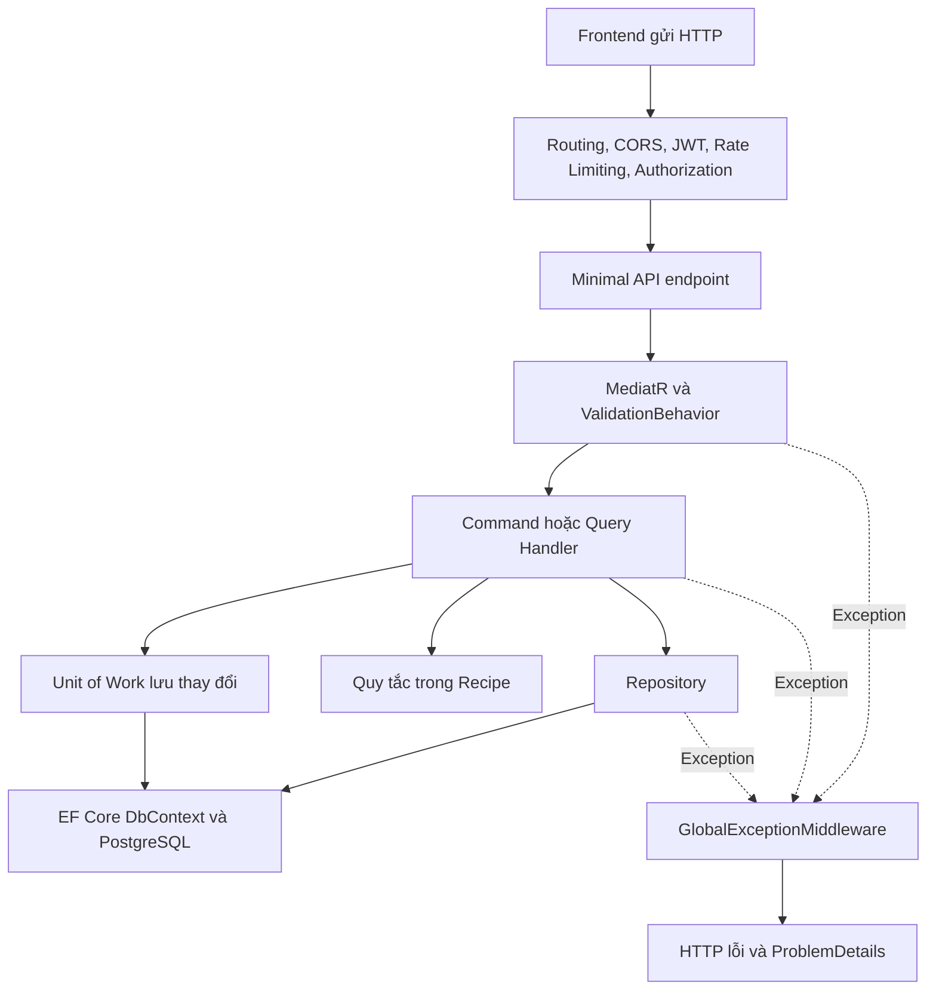

# Báo cáo tổng hợp công việc Chung Thiện Ý — Tuần 1 đến Tuần 5

- **Môn học:** Phát triển ứng dụng web nâng cao.
- **Sinh viên:** Chung Thiện Ý — **2312804**, Nhóm 18.
- **Dự án:** Culinary Blog — ứng dụng chia sẻ công thức nấu ăn.
- **Nhánh làm việc:** `2312804_ChungThienY_nhom18`.
- **Ngày tổng hợp và kết quả kiểm chứng gần nhất:** 13/10/2026.
- **Căn cứ:** [SRS v1.0.0, 71 trang](SRS_Culinary_Blog_v1.0.0.pdf), [phân công chi tiết](phan_cong_chi_tiet_theo_buoi.md), [quyết định giải quyết mâu thuẫn SRS](phan-tich-mau-thuan-SRS-v1.0.0.md) và mã nguồn hiện có.

Tài liệu này gộp nội dung báo cáo Recipe tuần 1–5 và báo cáo yêu cầu tối thiểu tuần 5. Mục đích là giải thích **đã thực hiện gì, vì sao cần thực hiện, mã nằm ở đâu và đã kiểm chứng bằng cách nào**, để sinh viên đọc hiểu và trình bày được phần việc của mình.

## 1. Phạm vi và cách đọc báo cáo

Theo bảng phân công cập nhật, từ tuần 3 nhóm chuyển sang giao module cho từng người. Phần nghiệp vụ chính của Chung Thiện Ý là **Recipe Create/Read, Update và Publish**. Không lấy lại các chức năng từng xuất hiện trong bảng chia FR cũ nhưng sau đó đã chuyển cho thành viên khác.

Phần hạ tầng dùng chung và frontend để đáp ứng yêu cầu tối thiểu tuần 5 được bổ sung theo xác nhận của sinh viên. Phạm vi này gồm CORS, Rate Limiting, Authentication/Authorization, OpenAPI/Scalar, API versioning, môi trường, thư viện và TS types.

Trong báo cáo:

- **Dùng lại** nghĩa là sử dụng nền tảng đã có của nhóm, không nhận toàn bộ công viết nền tảng đó thành phần việc cá nhân.
- **Hoàn thiện/điều chỉnh** nghĩa là bổ sung hoặc sửa mã hiện có để phần việc chạy đúng và khớp đặc tả đã thống nhất.
- Các mục được sắp theo **nội dung phân công từng tuần**, không phải xác nhận rằng mọi thay đổi được viết đúng vào ngày diễn ra buổi học đó. Báo cáo cũng không thay thế bằng chứng tham dự họp.
- **“Hoàn thành tất cả API endpoints” của tuần 4 được đối chiếu với toàn bộ endpoint thuộc phần việc cá nhân được giao đến tuần 4.** Không đồng nghĩa với hoàn thành mọi endpoint của cả nhóm hoặc chức năng được giao cho các tuần sau.

### 1.1. Tổng quan theo tuần

| Tuần | Nội dung của Chung Thiện Ý | Kết quả trong dự án |
|---|---|---|
| 1 | Đọc, phân tích Auth, Category, Recipe và xác định phạm vi | Nắm quan hệ dữ liệu, quyền truy cập, quy tắc Recipe và các mâu thuẫn SRS cần áp dụng |
| 2 | Không có dòng giao riêng cho Chung Thiện Ý trong bảng cập nhật | Dùng nền tảng Clean Architecture, DbContext, Identity/JWT và DI do nhóm cung cấp |
| 3 | Recipe Create/Read; exceptions; repository và Unit of Work; ít nhất 2 endpoint; middleware toàn cục | Có 3 endpoint cơ bản và thêm đọc theo slug; sử dụng repository riêng, Unit of Work chung và ProblemDetails |
| 4 | Hoàn thành toàn bộ endpoint được giao; Recipe Update, RowVersion, slug | Hoàn thiện PUT; đủ 5 thao tác API đến tuần 4; kiểm tra quyền, dữ liệu đầu vào và xung đột 409 |
| 5 | Publish Recipe và các yêu cầu tối thiểu bổ sung | Thêm Publish; hoàn thiện bảo mật, đặc tả/versioning API, frontend, thư viện và TS types |

### 1.2. Kết quả kiểm chứng chung

| Kiểm tra | Kết quả gần nhất |
|---|---|
| Toàn bộ project `CulinaryBlog.UnitTests`, gồm kiểm thử HTTP | **83/83 đạt** |
| Trong số trên: kiểm thử bảo mật, versioning, OpenAPI | **17/17 đạt** |
| Chạy lại bộ HTTP Recipe trên PostgreSQL 16 và Redis 7 tạm | **14/14 đạt** |
| Kiểm thử frontend về demo, schema, callback URL | **5/5 đạt** |
| TypeScript strict và ESLint toàn frontend | **Đạt** |
| Build frontend Production, có standalone và Edge middleware | **Đạt** |
| Kiểm tra Auth trên bản standalone Production | **Đạt với backend giả lập localhost** |

**Cách hiểu số liệu:** 17 ca bảo mật nằm trong 83 ca backend; 14 ca PostgreSQL/Redis là chạy lại các ca HTTP Recipe với hệ lưu trữ thật. Không cộng các con số này thành số ca kiểm thử độc lập mới. Các ca vốn có của module khác trong project test cũng không được tính thành công việc cá nhân.

## 2. Tuần 1 — Phân tích yêu cầu và hiểu kiến trúc

### 2.1. Những yêu cầu đã phân tích

Đã đọc SRS gốc đủ 71 trang để hiểu toàn cảnh, tập trung vào Auth ở mục 3.1, Category ở mục 3.2 và Recipe ở mục 3.3. Phần Recipe được đối chiếu với FR-RCP-001–005 ở trang 27–32, mô hình dữ liệu trang 54–57 và API trang 63–64.

| Module | Nội dung cần hiểu | Liên quan đến phần Recipe |
|---|---|---|
| Auth | Đăng nhập, JWT, refresh token, vai trò Author/Admin | API cần biết ai đang gọi để lấy AuthorId và kiểm tra quyền |
| Category | Danh mục và quan hệ với Recipe | Tạo hoặc đổi danh mục phải kiểm tra CategoryId tồn tại |
| Recipe | Trạng thái, dữ liệu cơ bản, bước, nguyên liệu, quyền đọc/sửa | Là phần nghiệp vụ cá nhân triển khai từ tuần 3 |

Ví dụ: client không được tự gửi `authorId` để nhận quyền sở hữu. Người dùng đăng nhập nào tạo công thức thì backend lấy định danh người đó từ JWT. Nếu client sửa ID công thức trên URL sang công thức của người khác, backend vẫn phải kiểm tra chủ sở hữu.

### 2.2. Quan hệ dữ liệu

`Recipe` là thực thể trung tâm, chứa thông tin công thức và liên kết các dữ liệu liên quan:

- Một Recipe thuộc một **Category** và một **Author**.
- Một Recipe có nhiều **RecipeStep**, **RecipeIngredient**, **RecipeImage**.
- **RecipeNutrition** là owned entity: EF Core quản lý như một phần của Recipe; các cột dinh dưỡng nằm trong bảng Recipes.
- `IsDeleted` phục vụ xóa mềm. Global query filter loại các bản ghi đã xóa mềm khỏi truy vấn thông thường.
- `RowVersion` dùng phát hiện dữ liệu đã thay đổi; `PublishedAt` ghi thời điểm xuất bản.

“Aggregate root” ở đây nghĩa là Recipe đóng vai trò gốc của một nhóm dữ liệu liên quan. Khi tạo công thức kèm bước và nguyên liệu, handler có thể tạo cả nhóm rồi lưu một lần. Quy tắc có được xuất bản hay chưa được đặt trong `Recipe.Publish()`.

### 2.3. Vai trò của bốn tầng backend

| Tầng | Trách nhiệm | Ví dụ trong phần việc |
|---|---|---|
| Domain | Mô hình và quy tắc nghiệp vụ, không xử lý HTTP | Recipe, enum trạng thái, `Recipe.Publish()`, lỗi thiếu điều kiện Publish |
| Application | Điều phối một yêu cầu của ứng dụng | Command/Query Handler, validator, kiểm tra quyền sở hữu, DTO |
| Infrastructure | Cách truy cập database và dịch vụ bên ngoài | EF Core, RecipeRepository, DbContext, PostgreSQL, Redis |
| API | Nhận HTTP và trả phản hồi | Minimal API, JWT/policy, CORS, rate limiter, middleware |

Frontend Next.js gọi API thông qua các hook và `lib/api-client.ts`. Backend sử dụng CQRS: **Command** xử lý thay đổi dữ liệu; **Query** xử lý đọc dữ liệu. MediatR chuyển request đến đúng handler, còn FluentValidation kiểm tra dữ liệu đầu vào.



Luồng thành công trả DTO cho client. Khi có exception, lỗi được truyền ngược lên middleware thay vì mỗi endpoint tự tạo một kiểu phản hồi lỗi khác nhau.

### 2.4. Các quyết định giải quyết mâu thuẫn SRS đã áp dụng

| Quyết định | Hành vi được áp dụng | Lý do |
|---|---|---|
| #5 — concurrency | RowVersion cũ trả **409 Conflict** | Đây là xung đột với trạng thái hiện tại của tài nguyên |
| #6 — slug | Trùng slug tự thêm `-2`, `-3`… | Cho phép nhiều công thức có cùng tiêu đề |
| #7 — Publish | Cần ít nhất một bước **và** một nguyên liệu còn hiệu lực | Công thức công khai phải đủ nội dung cơ bản |
| #10 — Instructions | Trường legacy tùy chọn | Nội dung hướng dẫn chi tiết được biểu diễn bằng Steps |
| #3/#4 — cache | Dùng Output Cache/Redis sẵn có của nhóm, xóa tag liên quan sau mutation | Tránh giữ phản hồi cũ sau khi dữ liệu thay đổi |

`CookTime = 0` vẫn hợp lệ theo bảng Recipe trang 55 vì có món không cần nấu. SRS gốc gộp Publish/Unpublish trong FR-RCP-005, nhưng phân công cập nhật của Chung Thiện Ý tuần 5 chỉ yêu cầu **Publish**.

## 3. Tuần 2 — Sử dụng nền tảng chung của nhóm

Bảng cập nhật tuần 2 không giao riêng nhiệm vụ cho Chung Thiện Ý; các công việc khởi tạo backend và Auth cơ bản được giao cho Mai Văn Quang. Phần Recipe sử dụng lại nền tảng đó:

- Solution gồm Domain, Application, Infrastructure và API.
- Entity nền tảng, cấu hình EF Core, `CulinaryBlogDbContext` và cơ chế DI.
- Identity/JWT cung cấp tài khoản, định danh và role.
- `IRepository<T>`, `RepositoryBase<T>` và `IUnitOfWork` dùng chung.
- Hạ tầng xử lý exception, logging và các dịch vụ đã có của nhóm.

Điểm cần trình bày: **không viết lại DbContext hoặc hệ thống đăng nhập chỉ để phục vụ Recipe**. Phần cá nhân kết nối đúng với các interface và service đã có. Các điều chỉnh bảo mật/frontend dùng chung được trình bày riêng ở tuần 5 vì đã được duyệt bổ sung.

## 4. Tuần 3 — Recipe Create/Read và bốn yêu cầu tối thiểu

### 4.1. Bảng đối chiếu yêu cầu của giảng viên

| Yêu cầu tuần 3 | Cách đáp ứng trong phần Recipe | Bằng chứng mã nguồn |
|---|---|---|
| Cài đặt các lớp domain exceptions/lỗi nghiệp vụ | Có lỗi Recipe không tồn tại; lỗi dữ liệu và quyền dùng exception chung; các tuần tiếp theo bổ sung lỗi concurrency và Publish | [RecipeNotFoundException](../src/CulinaryBlog.Application/Common/Exceptions/RecipeNotFoundException.cs), [thư mục exception chung](../src/CulinaryBlog.Application/Common/Exceptions), [exception của Domain](../src/CulinaryBlog.Domain/Common/Exceptions/RecipePublishIncompleteException.cs) |
| Repository và Unit of Work | Repository riêng của Recipe kế thừa repository chung; lưu qua Unit of Work dùng cùng DbContext | [IRecipeRepository](../src/CulinaryBlog.Domain/Interfaces/IRecipeRepository.cs), [RecipeRepository](../src/CulinaryBlog.Infrastructure/Persistence/Repositories/RecipeRepository.cs), [IUnitOfWork](../src/CulinaryBlog.Domain/Interfaces/IUnitOfWork.cs) |
| Ít nhất 2 API endpoints/thành viên | Có POST tạo, GET danh sách, GET theo ID; thêm GET theo slug để frontend sử dụng | [RecipesEndpoints](../src/CulinaryBlog.API/Endpoints/RecipesEndpoints.cs) |
| Middleware bắt lỗi và trả ProblemDetails toàn cục | Dùng middleware chung, ánh xạ exception nghiệp vụ Recipe thành HTTP status và mã lỗi | [GlobalExceptionMiddleware](../src/CulinaryBlog.API/Middleware/GlobalExceptionMiddleware.cs), [Program](../src/CulinaryBlog.API/Program.cs) |

Phần dưới giải thích từng yêu cầu, không chỉ liệt kê tên lớp.

### 4.2. Exception nghiệp vụ là gì và đang đặt ở đâu?

Exception nghiệp vụ biểu diễn một tình huống không thể tiếp tục xử lý theo quy tắc ứng dụng, chẳng hạn không tìm thấy công thức. Dùng lớp riêng giúp middleware phân biệt lỗi bằng **kiểu exception**, không phải so sánh chuỗi thông báo.

Các lớp liên quan trong trạng thái mã nguồn đến cuối tuần 5:

| Lớp | Tầng thực tế | Khi phát sinh | Kết quả HTTP |
|---|---|---|---|
| `RecipeNotFoundException` | Application | Không tìm thấy Recipe theo ID/slug hoặc bản ghi đã bị xóa mềm | 404, `RECIPE_NOT_FOUND` |
| `ValidationException` | Application, dùng chung | Dữ liệu không hợp lệ, danh mục không tồn tại, If-Match thiếu/sai | 422, `VALIDATION_ERROR` và errors theo trường |
| `UnauthorizedException` | Application, dùng chung | Handler cần người dùng đăng nhập nhưng không có định danh hợp lệ | 401, `UNAUTHORIZED` |
| `ForbiddenAccessException` | Application, dùng chung | Người dùng không có quyền sửa tài nguyên | 403, `FORBIDDEN` |
| `RecipeConcurrencyConflictException` | Application, phần Update tuần 4 | RowVersion không khớp hoặc EF phát hiện tranh chấp khi lưu | 409, `RECIPE_CONCURRENCY_CONFLICT` |
| `RecipePublishIncompleteException` | **Domain**, phần Publish tuần 5 | Thiếu bước hoặc nguyên liệu còn hiệu lực | 400, `RECIPE_PUBLISH_INCOMPLETE` |

**Phân biệt tên yêu cầu với vị trí mã:** các lỗi điều phối như không tìm thấy tài nguyên và concurrency đang nằm ở Application. Lỗi vi phạm quy tắc `Recipe.Publish()` nằm ở Domain. Không phải mọi exception đều nằm trong project Domain, và không phải tất cả các lớp trong bảng đều được bổ sung ở tuần 3.

Domain chỉ ném lỗi nghiệp vụ; Domain không biết HTTP 400 hay ProblemDetails. Việc chọn HTTP status thuộc API. Nhờ vậy cùng quy tắc Publish có thể được gọi từ một luồng xử lý khác mà không cần phụ thuộc ASP.NET Core.

### 4.3. Repository giải quyết việc gì?

Repository gom cách đọc/ghi dữ liệu, giúp handler làm việc qua interface thay vì tự gắn với chi tiết EF Core ở mọi nơi.

- [IRepository<T>](../src/CulinaryBlog.Domain/Interfaces/IRepository.cs) khai báo thao tác chung: lấy theo ID, thêm, cập nhật, xóa và truy vấn.
- [RepositoryBase<T>](../src/CulinaryBlog.Infrastructure/Persistence/Repositories/RepositoryBase.cs) thực hiện các thao tác đó bằng DbSet.
- `IRecipeRepository` bổ sung các truy vấn đặc thù của công thức; `RecipeRepository` triển khai chúng.

| Phương thức riêng | Mục đích và cách sử dụng |
|---|---|
| `GetByIdWithDetailsAsync` | Đọc đầy đủ Category, Author, Steps, Ingredients, Images để trả trang chi tiết |
| `GetBySlugWithDetailsAsync` | Đọc chi tiết bằng đường dẫn dễ đọc, ví dụ `pho-bo` |
| `SlugExistsAsync` | Kiểm tra slug đã được sử dụng, kể cả bản ghi xóa mềm, để tránh tái sử dụng nhầm URL |
| `SetOriginalRowVersion` | Đặt token client đã đọc vào OriginalValue của EF khi cập nhật |
| `GetByIdForPublishingAsync` | Truy vấn có tracking, Include Steps/Ingredients cho Publish; bổ sung khi hoàn thiện tuần 5 |

Repository hiện còn có phương thức Search của module đã có trong nhóm. Báo cáo không nhận phần cài đặt Search đó thành công việc cá nhân.

**Tracking và AsNoTracking:** truy vấn chỉ đọc dùng `AsNoTracking()` để EF không theo dõi thay đổi không cần thiết. Truy vấn dùng để sửa/Publish cần tracking để Unit of Work lưu thay đổi trạng thái. Đây là hai mục đích khác nhau, nên không dùng một phương thức bất kỳ thay cho tất cả.

### 4.4. Unit of Work giải quyết việc gì?

Repository tiếp nhận thay đổi, còn Unit of Work quyết định lúc lưu các thay đổi đó. Trong dự án, [CulinaryBlogDbContext](../src/CulinaryBlog.Infrastructure/Persistence/CulinaryBlogDbContext.cs) triển khai `IUnitOfWork`; `SaveChangesAsync()` của EF Core thực hiện việc lưu.

Ví dụ tạo công thức:

1. Tạo Recipe với trạng thái Draft.
2. Thêm các Step và Ingredient vào collection của Recipe.
3. Gọi `recipeRepository.AddAsync(recipe)` để EF theo dõi cả nhóm dữ liệu.
4. Gọi `unitOfWork.SaveChangesAsync()` **một lần** để lưu aggregate.

Với PostgreSQL, các thay đổi trong lần SaveChanges đó được lưu trong transaction: thành công cùng nhau hoặc thất bại cùng nhau. Tránh tình trạng đã có công thức nhưng mới lưu được một phần nguyên liệu do tách lưu không hợp lý.

DI đăng ký repository và Unit of Work dùng **cùng instance DbContext trong request**. Nếu mỗi bên dùng một DbContext khác nhau, Unit of Work có thể không thấy các thay đổi repository đang theo dõi.

Interface còn có `ExecuteInTransactionAsync` cho trường hợp cần nhiều lần SaveChanges trong một transaction. Đây là nền tảng dùng chung; luồng Create Recipe hiện chỉ cần một SaveChanges. InMemory dùng trong test không thay thế được việc kiểm chứng transaction/trigger của PostgreSQL.

### 4.5. Các endpoint Create/Read đã hoàn thiện

| Endpoint | Hành vi | Quyền |
|---|---|---|
| `POST /api/v1/recipes` | Tạo Recipe Draft, có thể kèm bước/nguyên liệu | Author hoặc Admin |
| `GET /api/v1/recipes` | Trả danh sách phân trang và meta | Published công khai; người đăng nhập được xem thêm theo quyền |
| `GET /api/v1/recipes/{id}` | Đọc chi tiết theo Guid | Published công khai; Draft/Archived chỉ owner hoặc Admin |
| `GET /api/v1/recipes/{slug}` | Đọc chi tiết bằng slug cho trang frontend | Cùng quy tắc với đọc theo ID |

Như vậy tuần 3 có **3 endpoint cơ bản theo phân công**, vượt mức tối thiểu 2 endpoint/thành viên; endpoint đọc theo slug là phần hỗ trợ frontend bổ sung. `/{id:guid}` và `/{slug}` được định tuyến riêng.

**Luồng Create** nằm chủ yếu trong [CreateRecipeCommandHandler](../src/CulinaryBlog.Application/Features/Recipes/Commands/CreateRecipe/CreateRecipeCommandHandler.cs): kiểm tra người dùng → kiểm tra Category → sinh slug duy nhất → tạo aggregate Draft → lưu qua Unit of Work → xóa cache tag recipes → đọc lại DTO, có RowVersion do DB sinh.

**Luồng Read:** [GetRecipesQueryHandler](../src/CulinaryBlog.Application/Features/Recipes/Queries/GetRecipesQueryHandler.cs) áp dụng quyền trước khi phân trang. Khách chỉ thấy Published; Author thấy Published và Draft/Archived của mình; Admin thấy mọi Recipe chưa xóa mềm. Đọc chi tiết sai quyền trả 403, không có tài nguyên trả 404.

### 4.6. Các ràng buộc dữ liệu đã đồng bộ

| Trường | Quy tắc |
|---|---|
| Title | Ít nhất 5 ký tự sau khi bỏ khoảng trắng đầu/cuối; tối đa 200 ký tự |
| Description | Bắt buộc; tối đa 2.000 ký tự |
| CategoryId | Guid hợp lệ và phải tồn tại, chưa xóa mềm; không tồn tại trả 422 theo trường |
| PrepTime | Lớn hơn 0 |
| CookTime | Lớn hơn hoặc bằng 0 |
| Servings | Lớn hơn 0 |
| Difficulty | Giá trị enum hợp lệ: Easy, Medium, Hard, Expert |
| Instructions | Tùy chọn; tối đa 10.000 ký tự |
| Steps/Ingredients khi tạo | Draft được phép chưa đủ; nếu gửi dữ liệu thì kiểm tra trường và thứ tự theo validator |

Validator backend là nơi quyết định cuối cùng; frontend dùng Zod để báo lỗi sớm. Không được chỉ kiểm tra ở giao diện vì người dùng có thể gọi API trực tiếp.

### 4.7. Middleware toàn cục và ProblemDetails

`GlobalExceptionMiddleware` bao quanh phần xử lý phía sau bằng try/catch. Handler chỉ ném exception; middleware chọn status, mã lỗi, thông báo và định dạng JSON thống nhất.

Ví dụ lỗi Publish thiếu dữ liệu, được bổ sung ở tuần 5 nhưng dùng cùng cơ chế middleware:

```json
{
  "type": "RECIPE_PUBLISH_INCOMPLETE",
  "title": "Công thức chưa đủ điều kiện để xuất bản",
  "status": 400,
  "detail": "Công thức phải có ít nhất 1 bước thực hiện và 1 nguyên liệu để xuất bản.",
  "instance": "/api/v1/recipes/<id>/publish"
}
```

Ví dụ lỗi đầu vào có thêm `errors`, như `"errors": { "Title": ["Tên công thức phải có ít nhất 5 ký tự."] }`. Response có Content-Type `application/problem+json`. Lỗi ngoài dự kiến được log ở server, trả 500 với thông báo chung, không trả stack trace cho client.

Không cần thêm try/catch trùng lặp vào mọi endpoint. JWT challenge/forbidden và rate limiter không nhất thiết phát sinh exception; ở tuần 5 chúng được cấu hình trả ProblemDetails ngay trong callback riêng để vẫn thống nhất định dạng.

## 5. Tuần 4 — Hoàn thành API được giao, Update, concurrency và slug

### 5.1. Đối chiếu yêu cầu “tất cả API endpoints”

Đến tuần 4, phần phân công cá nhân gồm Create/Read từ tuần 3 và **Update** ở tuần 4. Có đủ **5 thao tác API**: POST tạo, GET danh sách, GET theo ID, GET theo slug và PUT cập nhật.

Endpoint mới của tuần 4 là **`PUT /api/v1/recipes/{id}`**. Luồng đã có request, command, validator, handler, repository, lưu dữ liệu, phân quyền, xử lý concurrency và phản hồi; không chỉ khai báo route rồi để trống xử lý.

Các endpoint CRUD nguyên liệu/bước/ảnh được giao cho Hồ Quốc Tiến; Archive, Delete/Purge và Sitemap thuộc phần việc khác. Không lấy những endpoint đó để tính vào số endpoint cá nhân hoặc tuyên bố toàn bộ API của cả nhóm đã hoàn tất.

### 5.2. Luồng cập nhật

Mã chính: [UpdateRecipeCommandHandler](../src/CulinaryBlog.Application/Features/Recipes/Commands/UpdateRecipe/UpdateRecipeCommandHandler.cs) và [ConcurrencyTokenHelper](../src/CulinaryBlog.Application/Common/Helpers/ConcurrencyTokenHelper.cs).

1. Đọc và giải mã header If-Match thành RowVersion.
2. Tải Recipe có tracking; không có thì ném RecipeNotFoundException.
3. Kiểm tra quyền owner/Admin bằng [RecipeAuthorization](../src/CulinaryBlog.Application/Common/Authorization/RecipeAuthorization.cs).
4. So RowVersion client gửi với phiên bản hiện tại; cũ thì trả 409 sớm.
5. Nếu đổi Category, kiểm tra danh mục mới tồn tại; sai thì trả 422.
6. Cập nhật trường được gửi; xử lý slug theo trạng thái.
7. Đặt RowVersion client thành OriginalValue để EF tiếp tục kiểm tra khi lưu.
8. SaveChanges; nếu EF báo DbUpdateConcurrencyException thì chuyển thành lỗi Recipe 409.
9. Xóa cache liên quan và đọc lại DTO với RowVersion mới.

Theo hợp đồng hiện có của dự án, PUT nhận các trường tùy chọn: trường không gửi hoặc null giữ giá trị cũ. Không nên suy ra rằng mọi API PUT ở hệ thống khác đều có cùng cách cập nhật này.

### 5.3. Vì sao cần RowVersion và If-Match?

Giả sử hai người cùng mở bản công thức phiên bản A:

| Bước | Người thứ nhất | Người thứ hai |
|---|---|---|
| 1 | Đọc Recipe, giữ token A | Đọc Recipe, giữ token A |
| 2 | Gửi PUT kèm If-Match A; lưu thành công | Vẫn đang chỉnh bản cũ |
| 3 | Database sinh token B | Gửi PUT kèm If-Match A |
| 4 | Dữ liệu mới được giữ lại | Nhận 409, cần tải lại trước khi sửa |

Nếu không có concurrency check, lần lưu sau có thể ghi đè dữ liệu mới mà người thứ hai chưa nhìn thấy. **RowVersion là phiên bản bản ghi, không phải token đăng nhập.** Trong dự án, PostgreSQL `touch_row()` sinh token bytea 8 byte; API trả dưới dạng Base64. C# production không tự tạo token này.

Kiểm tra sớm bằng so sánh token giúp báo lỗi nhanh. Đặt OriginalValue cho EF bảo vệ thêm trường hợp một request khác lưu xen vào sau bước kiểm tra sớm nhưng trước SaveChanges.

If-Match thiếu, sai Base64, sai độ dài hoặc wildcard `*` bị từ chối bằng 422. Token hợp lệ về định dạng nhưng đã cũ trả 409. Đây là hai loại lỗi khác nhau.

### 5.4. Slug và đường dẫn ổn định

Slug là phần đường dẫn dễ đọc, ví dụ tiêu đề “Phở bò” tạo slug `pho-bo`. Nếu đã tồn tại, lần tạo tiếp theo nhận `pho-bo-2`, rồi `pho-bo-3`… Không bắt người dùng đổi tiêu đề chỉ vì có công thức trùng tên.

- Với Draft, đổi tiêu đề có thể sinh slug mới và kiểm tra trùng.
- Với Recipe đang Published, đổi tiêu đề giữ slug hiện tại để không làm hỏng đường dẫn công khai.
- Kiểm tra slug tính cả bản ghi xóa mềm, tránh tái sử dụng nhầm một URL đã có.

Đã kiểm thử tạo trùng tiêu đề, đổi slug của Draft, giữ slug khi sửa Published và từ chối RowVersion cũ. Không suy rộng kết quả này thành kiểm thử tải đồng thời cho mọi tình huống tranh chấp unique slug.

## 6. Tuần 5 — Publish Recipe

### 6.1. Endpoint và quy tắc

Endpoint **`PATCH /api/v1/recipes/{id}/publish`** gọi [PublishRecipeCommandHandler](../src/CulinaryBlog.Application/Features/Recipes/Commands/PublishRecipe/PublishRecipeCommandHandler.cs). Endpoint yêu cầu Author/Admin; handler kiểm tra tiếp quyền sở hữu.

Quy tắc trong [Recipe.Publish()](../src/CulinaryBlog.Domain/Entities/Recipe.cs): cần ít nhất **một Step chưa xóa mềm và một Ingredient chưa xóa mềm**. Thiếu một trong hai thì ném RecipePublishIncompleteException với thông báo nêu rõ phần thiếu.

Khi đủ dữ liệu, Recipe chuyển sang Published và ghi PublishedAt nếu chưa có. Gọi lại khi đã Published giữ nguyên thời điểm xuất bản; handler không SaveChanges hoặc xóa cache thêm lần nữa. Cách gọi lặp không gây thay đổi thêm này được gọi là **idempotent** trong ngữ cảnh thao tác hiện tại.

### 6.2. Lỗi đã phát hiện và sửa

Handler trước đó dùng `GetByIdAsync`, chỉ tải Recipe mà không Include Steps/Ingredients. Trong một request mới, các collection này có thể rỗng dù database đã có dữ liệu, khiến Publish bị từ chối sai.

Đã bổ sung `GetByIdForPublishingAsync` để tải aggregate có tracking và Include phần con. Domain kiểm tra cả cờ IsDeleted; Unit of Work lưu trạng thái mới. Kiểm thử xóa ChangeTracker sau khi seed dữ liệu để các navigation có sẵn từ bước seed không che giấu lỗi thiếu Include.

Handler cũng chuyển lỗi concurrency khi lưu thành 409 và đọc lại DTO sau khi lưu. Không triển khai thêm endpoint Unpublish.

### 6.3. Xóa cache đúng dữ liệu bị ảnh hưởng

| Thao tác thành công | Tag backend được xóa |
|---|---|
| Create | `recipes` |
| Update | `recipes`, `recipe-{id}`, `search`, `categories` |
| Publish có thay đổi trạng thái | `recipes`, `recipe-{id}`, `search`, `categories` |
| Publish lặp khi đã Published | Không lưu lại hoặc xóa cache thêm |

Ví dụ: Category list có `recipeCount`. Publish làm số công thức công khai tăng, nên chỉ xóa cache Recipe sẽ chưa đủ; cần xóa cache Category. Search cũng cần được làm mới để công thức vừa xuất bản xuất hiện ngay.

Đây là sử dụng hạ tầng Output Cache/Redis sẵn có, không viết lại Search hoặc Category. Policy RecipeDetail đã được nhóm khai báo, nhưng việc gắn cache cho GET theo slug thuộc phân công tuần 6, chưa được thực hiện thêm trong phạm vi này. Cache backend HTTP và cache giao diện TanStack Query có mục đích khác nhau.

## 7. Tuần 5 — Năm yêu cầu tối thiểu về hạ tầng và frontend

### 7.1. CORS, Rate Limiting, Authentication/Authorization

Mã cấu hình tập trung tại [ApiSecurityExtensions](../src/CulinaryBlog.API/Extensions/ApiSecurityExtensions.cs), policy tại [AuthorizationPolicies](../src/CulinaryBlog.API/Extensions/AuthorizationPolicies.cs), thứ tự middleware tại Program.

**CORS:** frontend thường chạy ở `http://localhost:3000`, API ở cổng khác. Trình duyệt cần được API cho phép origin frontend. Cấu hình đọc Cors:AllowedOrigins, từ chối wildcard và giá trị origin không hợp lệ; cho phép các method cần thiết cùng Authorization, Content-Type, Accept, If-Match, X-Correlation-ID. Trình duyệt được đọc thêm Retry-After, ETag, X-Correlation-ID, api-supported-versions.

CORS kiểm soát truy cập chéo origin của trình duyệt, **không thay thế đăng nhập và phân quyền**. Client ngoài trình duyệt vẫn cần JWT và phải qua các policy của API.

**Authentication:** JWT chỉ nhận HS256, kiểm tra issuer, audience, chữ ký và thời hạn; secret tối thiểu 32 byte, đặt qua User Secrets/biến môi trường. JWT thiếu, sai hoặc hết hạn trả 401 ProblemDetails và WWW-Authenticate: Bearer.

**Authorization:** policy yêu cầu đã xác thực rồi kiểm tra role. AuthorPolicy cho Author/Admin; AdminPolicy chỉ cho Admin. Với sửa/Publish Recipe, kiểm tra thêm owner ở Application. Nhóm Files được bảo vệ bằng Author/Admin để không cấp URL upload khi chưa xác thực. Thiếu quyền trả 403 ProblemDetails.

**Rate Limiting:** hạn chế số request trong một khoảng thời gian, tránh một nguồn gửi quá nhiều yêu cầu vào API.

| Nhóm | Giới hạn | Cách chia ngân sách |
|---|---|---|
| API | 100 yêu cầu/phút | Theo user ID đã xác thực; khách theo IP kết nối |
| Auth | 10 yêu cầu/phút | Theo IP, dùng chung giữa các endpoint /auth/* |
| Health/preflight | Không dùng ngân sách API như request nghiệp vụ | Giữ health check và preflight hoạt động |

Vượt giới hạn trả **429 RATE_LIMIT_EXCEEDED**, kèm Retry-After theo giây và ProblemDetails; không xếp hàng. Đổi endpoint Auth không tạo ngân sách mới để lách giới hạn. Limiter chạy trong tiến trình API, chưa triển khai ngân sách dùng chung cho nhiều replica. IP là địa chỉ kết nối thực; không tin X-Forwarded-For tùy ý, triển khai qua proxy cần cấu hình trusted proxy riêng.

Thứ tự chính: **exception → routing → CORS → authentication → rate limiter → authorization → output cache**. Authentication xác định người dùng trước khi limiter chia ngân sách theo user; authorization chạy trước khi phục vụ output cache.

### 7.2. Sinh đặc tả API và API versioning

Đã bổ sung `Asp.Versioning.Http` **10.2.0**, dùng [MapV1Group](../src/CulinaryBlog.API/Extensions/ApiVersioningExtensions.cs) cho Auth, Recipe, Recipe Items, Category và Files. Version được đọc từ URL segment, giữ URL `/api/v1/...`, báo api-supported-versions: 1.0 và từ chối version không hỗ trợ. Health check giữ URL không version.

**API version là phiên bản hợp đồng của API**, khác với RowVersion của một bản ghi. API v1 cho biết client đang gọi bộ hợp đồng nào; If-Match cho biết client đang sửa phiên bản dữ liệu nào.

[OpenApiExtensions](../src/CulinaryBlog.API/Extensions/OpenApiExtensions.cs) sinh tài liệu tại `/openapi/v1.json`; giao diện Scalar tại `/scalar/v1`, chỉ mở ở Development. Document mô tả tên/version API, request/response, Bearer, If-Match bắt buộc cho Update Recipe và các lỗi liên quan. Endpoint công khai không bị gắn yêu cầu Bearer nhầm.

[ApiResponseExtensions](../src/CulinaryBlog.API/Extensions/ApiResponseExtensions.cs) dùng typed result với ApiEnvelope/PagedApiEnvelope để OpenAPI nhận biết schema phản hồi. Không chỉ có route trong tài liệu nhưng thiếu cấu trúc data/meta. Tài liệu còn mô tả Retry-After của 429, concurrency 409 và Publish incomplete 400. Production không công khai OpenAPI/Scalar; không thêm API v2.

### 7.3. Môi trường và cấu trúc frontend

Frontend sử dụng Next.js App Router và TypeScript, giữ cấu trúc sẵn có:

```text
frontend/
  app/               Các route, layout, API route của Next.js
  components/        Giao diện, form và thành phần tái sử dụng
  hooks/             Query/mutation gọi dữ liệu
  lib/               API client, tiện ích, schema validation
  types/             Kiểu dữ liệu dùng chung và theo module
  scripts/           Thiết lập môi trường và kiểm tra Production
  tests/             Kiểm thử frontend
  public/            Tài nguyên tĩnh
```

`npm run setup` dùng [setup-env.mjs](../frontend/scripts/setup-env.mjs) tạo `.env.local` từ mẫu và sinh AUTH_SECRET nếu chưa có file. Nếu đã có thì giữ nguyên, không ghi đè secret/cấu hình của sinh viên. [.env.local.example](../frontend/.env.local.example) ghi rõ các biến cần cấu hình.

| Biến | Mục đích |
|---|---|
| NEXT_PUBLIC_API_BASE_URL | URL API dùng bởi trình duyệt, mặc định http://localhost:5000/api/v1; được đóng vào bundle lúc build |
| API_INTERNAL_BASE_URL | URL riêng để Next.js server gọi API, tùy chọn, hữu ích khi chạy Docker |
| AUTH_SECRET | Secret của Auth.js; phải cấp riêng theo môi trường |
| NEXTAUTH_URL / AUTH_URL | URL frontend; dùng domain HTTPS khi triển khai |
| AUTH_DEMO_ENABLED | Cờ bật demo, chỉ có tác dụng ở Development |
| AUTH_GOOGLE_ID / AUTH_GOOGLE_SECRET | Cấu hình Google OAuth tùy chọn |
| Jwt__Secret / Jwt__Issuer / Jwt__Audience | Cấu hình JWT backend qua biến môi trường |
| Cors__AllowedOrigins__0 | Origin frontend mà backend cho phép |

[next.config.ts](../frontend/next.config.ts) giữ output standalone và giới hạn một worker build để giảm lỗi cấp phát/tạo tiến trình khi máy chạy cùng Docker/.NET. Build sử dụng Google Fonts theo cấu hình đã có, cần kết nối tải font; không đổi giao diện/font.

### 7.4. Thư viện cần thiết

| Thư viện | Vai trò |
|---|---|
| Next.js 15, React 19 | Framework và giao diện frontend |
| TypeScript | Kiểm tra kiểu tĩnh, chế độ strict |
| Auth.js v5 / next-auth | Quản lý phiên đăng nhập và kết nối backend Auth |
| TanStack Query | Đọc, cache và làm mới dữ liệu giao diện |
| React Hook Form + Zod | Quản lý form và kiểm tra dữ liệu nhập |
| Tailwind, clsx, tailwind-merge, lucide-react | Styling và thành phần UI |
| ESLint, eslint-config-next | Kiểm tra chất lượng mã |
| @eslint/eslintrc 3.3.7 | Dependency trực tiếp cho cấu hình lint đang sử dụng |
| Asp.Versioning.Http 10.2.0 | Versioning cho backend Minimal API |

Các thư viện chính đã có của nhóm được kiểm tra, dùng lại; package.json và lockfile được đồng bộ. Không nhận toàn bộ việc cài framework ban đầu thành phần cá nhân. Frontend yêu cầu Node.js 20 trở lên; phiên kiểm chứng dùng 24.16.0. Cài theo lockfile bằng `npm ci`. Kiểm thử frontend dùng Node test runner và TypeScript đã có, không thêm test framework.

### 7.5. TS types và đồng bộ với backend

TypeScript types mô tả cấu trúc dữ liệu mà frontend nhận/gửi. Nếu API trả object khác với type khai báo, code có thể đọc sai trường hoặc gửi sai body dù giao diện vẫn hiển thị.

| Tệp | Kiểu dữ liệu được quản lý |
|---|---|
| [common.ts](../frontend/types/common.ts) | ApiEnvelope, PageMeta, PagedResult, ProblemDetails, mã lỗi |
| [user.ts](../frontend/types/user.ts) | UserRole, UserProfile, AuthTokenResponse, input Auth và RegistrationResponse |
| [recipe.ts](../frontend/types/recipe.ts) | Enum dạng chuỗi, RecipeSummary/Detail, Nutrition, các phần con và input tạo/sửa |
| [category.ts](../frontend/types/category.ts) | Category và CategoryInput |
| [file.ts](../frontend/types/file.ts) | Request presigned upload, response URL upload và metadata file |
| [next-auth.d.ts](../frontend/types/next-auth.d.ts) | Khai báo bổ sung Session/User/JWT cho Auth.js |
| [index.ts](../frontend/types/index.ts) | Export tập trung các types của ứng dụng |

Ví dụ: `instructions` của RecipeDetail là `string | null`; trường nullable không được khai là luôn có chuỗi. Guid và ngày giờ JSON được nhận dưới dạng string; RowVersion là string Base64; dinh dưỡng có thể null. RecipeSummary và RecipeDetail được tách vì cấu trúc phản hồi thực tế khác nhau.

TypeScript types không tự kiểm tra JSON ở runtime. Zod/FluentValidation bổ sung việc kiểm tra dữ liệu thật. Đã sửa 8 lỗi TypeScript cũ do form dùng email/userName/fullName không khớp schema account; không tắt strict để bỏ qua lỗi. ESLint bỏ qua .next/out/build sinh tự động để chỉ kiểm tra mã nguồn cần quản lý.

### 7.6. Authentication frontend và demo Development

[auth.config.ts](../frontend/auth.config.ts) chứa callback dùng chung cho Edge, không import filesystem Node. [auth.ts](../frontend/auth.ts) chứa provider phía server; [middleware.ts](../frontend/middleware.ts) dùng cấu hình Edge để bảo vệ dashboard/profile và trang quản trị Category.

Trước khi điều chỉnh, tài khoản local tạo `local-token-*`, không phải JWT backend nên không gọi được API có bảo vệ. Đã tách rõ:

- **Mặc định/Production:** đăng nhập bằng email, xác thực qua backend. Đăng ký chuyển FullName/Email/UserName/Password sang backend, không ghi users.json cục bộ. Mật khẩu tối thiểu 8 ký tự, có chữ hoa, số, ký tự đặc biệt.
- **Demo:** chỉ bật khi NODE_ENV=development **và** AUTH_DEMO_ENABLED=true. Cờ true ở Production vẫn không bật demo; token demo cũ bị loại ngoài chế độ demo. Giao diện báo rõ giới hạn; hook không gửi local-token sang backend.
- Auth.js giữ refresh token trong JWT cookie; session client nhận access token, user và roles. Refresh thất bại thì xóa token/quyền để yêu cầu đăng nhập lại.
- Callback URL bị giới hạn trong ứng dụng. Trang login/register đọc cờ cấu hình lúc chạy. Google chỉ hiện khi đủ Google ID/Secret; chưa kiểm chứng Google với tài khoản ngoài thực tế.

Muốn xem demo, thêm `AUTH_DEMO_ENABLED=true` vào `.env.local`, chạy `npm run dev`. Demo không cấp quyền tạo/sửa/xuất bản dữ liệu backend. Muốn kiểm chứng Recipe cần tài khoản backend thật.

## 8. Các điều chỉnh frontend Recipe và database

### 8.1. Giao diện Recipe đã hoàn thiện

- Wizard gửi đúng tên trường API, không ép Instructions thành bắt buộc và chuyển sang trang chỉnh sửa sau khi tạo.
- Form chỉnh sửa gửi If-Match; Publish hiển thị thông báo thành công hoặc lỗi từ backend. Đã bỏ nút có nhãn Publish nhưng gọi nhầm /unpublish.
- Cache danh sách/chi tiết Recipe phân biệt người dùng, chờ session tải xong trước khi query. Tránh đổi tài khoản nhưng thấy lại dữ liệu nháp của phiên trước.
- Update/Publish làm mới cache Recipe và Category ở giao diện, cùng với việc backend xóa output cache.
- Dashboard dùng pageSize=50 đúng giới hạn API, thay cho 100 gây 422. Thông báo danh sách phản ánh Published và bản nháp/lưu trữ theo quyền; số liệu tổng quan chỉ tính tối đa 50 bản ghi đang tải.

Mã chính: [useRecipes](../frontend/hooks/useRecipes.ts), [RecipeWizardForm](../frontend/components/forms/RecipeWizardForm.tsx), [RecipeEditForm](../frontend/components/forms/RecipeEditForm.tsx).

### 8.2. Instructions nullable và database đang có

Sinh viên xác nhận database được tạo bằng Docker với `db/init/*.sql`. Đã đồng bộ Instructions tùy chọn ở command, DTO, entity, EF configuration, TypeScript type và [SQL khởi tạo](../db/init/02-schema.sql).

Database đã tồn tại cần [script cập nhật cột](../db/patches/recipe-instructions-nullable.sql):

```sql
BEGIN;
ALTER TABLE "Recipes" ALTER COLUMN "Instructions" DROP NOT NULL;
COMMIT;
```

Script giữ nguyên dữ liệu, có thể chạy lại. **Chưa áp dụng vào database hiện có của nhóm**, theo lựa chọn để sinh viên chủ động thực hiện. Chỉ khởi động lại Docker không tự cập nhật cột trong volume đã có; không cần xóa volume hoặc tạo lại dữ liệu.

Migration EF ban đầu và snapshot được giữ làm lịch sử. Không chạy thêm cơ chế quản lý schema khác lên database SQL hiện có khi nhóm chưa thống nhất chuyển đổi.

## 9. Ví dụ để tự kiểm tra và trình bày

### 9.1. Tạo công thức có thể xuất bản

Gửi POST /api/v1/recipes với Authorization: Bearer <JWT thật>. Thay CategoryId bằng Guid có thật; không gửi AuthorId.

```json
{
  "title": "Phở bò gia đình",
  "description": "Công thức phở bò cho bốn người",
  "categoryId": "<GUID danh mục có thật>",
  "prepTime": 20,
  "cookTime": 60,
  "servings": 4,
  "difficulty": "Easy",
  "ingredients": [
    { "name": "Thịt bò", "quantity": 0.5, "unit": "kg", "orderIndex": 0 }
  ],
  "steps": [
    { "stepNumber": 1, "title": "Nấu nước dùng", "description": "Ninh xương với lửa nhỏ." }
  ]
}
```

Kết quả mong đợi: 201, data có id, slug, status Draft và rowVersion. Instructions có thể bỏ qua. Chưa Publish thì khách không được đọc chi tiết bản nháp.

### 9.2. Sửa và tạo tình huống xung đột

1. Lưu rowVersion từ response tạo/đọc.
2. Gửi PUT /api/v1/recipes/{id}, header If-Match chứa token đó, body `{"title":"Phở bò gia đình đặc biệt"}`.
3. Nhận 200 với rowVersion mới.
4. Gửi lại PUT bằng **token cũ**: nhận 409 RECIPE_CONCURRENCY_CONFLICT.

Không tự tạo một token Base64 ngẫu nhiên để cập nhật; phải gửi đúng phiên bản client đã đọc. Thiếu If-Match sẽ nhận lỗi dữ liệu 422.

### 9.3. Xuất bản và kiểm tra quyền đọc

Gửi PATCH /api/v1/recipes/{id}/publish bằng owner hoặc Admin. Nếu có đủ bước/nguyên liệu, nhận 200 và status Published, PublishedAt có giá trị. Khách đọc được công thức đã xuất bản.

Tạo Draft khác thiếu bước hoặc nguyên liệu rồi gọi Publish để nhận 400 với thông báo phần thiếu. Đăng nhập Author khác rồi sửa/Publish công thức không thuộc mình để nhận 403. Gọi Publish lặp trên bản đã Published để kiểm tra PublishedAt/RowVersion không đổi chỉ vì gọi lặp.

### 9.4. Bảng mã lỗi cần nhớ

| Tình huống | HTTP/mã lỗi thực tế |
|---|---|
| JWT thiếu, sai hoặc hết hạn ở endpoint bảo vệ | 401 AUTH_TOKEN_INVALID |
| Sai role hoặc quyền sở hữu | 403 FORBIDDEN |
| Recipe không tồn tại/đã xóa mềm | 404 RECIPE_NOT_FOUND |
| RowVersion đã cũ/tranh chấp khi lưu | 409 RECIPE_CONCURRENCY_CONFLICT |
| Publish thiếu bước/nguyên liệu | 400 RECIPE_PUBLISH_INCOMPLETE |
| Tiêu đề, CategoryId, If-Match hoặc dữ liệu đầu vào sai | 422 VALIDATION_ERROR |
| Vượt ngân sách request | 429 RATE_LIMIT_EXCEEDED, có Retry-After |
| Lỗi ngoài dự kiến | 500 INTERNAL_SERVER_ERROR, không lộ stack trace |

## 10. Kiểm thử đã thực hiện và cách chạy lại

### 10.1. Các nhóm kiểm thử

| Nhóm | Những gì được xác nhận |
|---|---|
| Domain Publish | Đủ/thiếu dữ liệu; phần con xóa mềm; PublishedAt; gọi lặp |
| Handler Publish | Repository tải đủ navigation sau khi clear tracking; owner/Admin; không tồn tại; concurrency; cache |
| HTTP Recipe | Endpoint thật qua Kestrel, MediatR, validator, middleware và JWT; Create/Read/Update/Publish; slug; lỗi theo trường |
| PostgreSQL/Redis | Trigger RowVersion thật; lưu Instructions NULL; script nullable chạy hai lần; cache được tạo trước mutation và làm mới sau mutation |
| Security HTTP | CORS whitelist/If-Match; JWT sai chữ ký/issuer/audience/hết hạn; role; Files; 429; phân vùng limiter; versioning; OpenAPI và Scalar |
| Frontend unit | Demo chỉ ở Development; phân biệt token local; callback URL; schema Production và schema demo |
| Frontend Production | Tắt demo dù cờ=true; login/register đi backend giả lập; session không lộ refresh token; bảo vệ route; users.json không đổi |

Tệp kiểm thử: [RecipePublishTests](../tests/CulinaryBlog.UnitTests/Recipes/RecipePublishTests.cs), [PublishRecipeCommandHandlerTests](../tests/CulinaryBlog.UnitTests/Recipes/PublishRecipeCommandHandlerTests.cs), [RecipeApiTests](../tests/CulinaryBlog.UnitTests/Recipes/RecipeApiTests.cs), [SecurityInfrastructureTests](../tests/CulinaryBlog.UnitTests/Api/SecurityInfrastructureTests.cs), [frontend tests](../frontend/tests/auth-mode.test.mjs).

InMemory chỉ phục vụ kiểm tra logic và mô phỏng token trong test. PostgreSQL dùng chính trigger của dự án. Host test không chạy Program/seeder trên database nhóm. Endpoint đếm Recipe để kiểm tra cache Create chỉ tồn tại trong host test, không được thêm vào API production.

### 10.2. Lệnh chạy lại

Từ thư mục gốc repository:

```powershell
dotnet restore tests/CulinaryBlog.UnitTests/CulinaryBlog.UnitTests.csproj
dotnet test tests/CulinaryBlog.UnitTests/CulinaryBlog.UnitTests.csproj --no-restore --disable-build-servers -m:1 -p:UseSharedCompilation=false
```

Mở Docker Desktop, có sẵn image postgres:16-alpine và redis:7-alpine, rồi chạy:

```powershell
.\test-chung-thien-y-tuan-1-5.ps1
```

[Script PostgreSQL/Redis](../test-chung-thien-y-tuan-1-5.ps1) tạo hai container, cổng ngẫu nhiên và database tạm có tiền tố culinary_recipe_tests_, không dùng volume nhóm; tự dọn trong finally. Test từ chối connection string không mang tên database tạm theo quy tắc này.

Frontend:

```powershell
cd frontend
npm ci
npm run type-check
npm run lint
npm run test
npm run build
npm run test:production-auth
```

[Script Production Auth](../frontend/scripts/test-production-auth.mjs) chạy bản standalone và backend giả lập trên localhost/cổng ngẫu nhiên, tự dọn tiến trình. Kiểm tra này xác nhận kết nối/session frontend; không thay thế kiểm thử JWT thật của backend hoặc đăng nhập Google với tài khoản thực.

Khi triển khai standalone, dùng node .next/standalone/server.js hoặc Dockerfile sẵn có. Cấp secret riêng và cấu hình URL/mạng theo môi trường triển khai; không dùng secret của máy phát triển làm secret phát hành.

## 11. Gợi ý đọc mã và trình bày phần việc

Đọc theo thứ tự: **RecipesEndpoints → command/query → validator → handler → interface repository → repository/DbContext → middleware → test tương ứng**. Với Publish, đọc thêm Recipe.Publish() và exception trong Domain. Với frontend, đọc types → api-client → hook → form.

| Nội dung cần giải thích | Ý chính để trình bày |
|---|---|
| Vì sao có repository và Unit of Work? | Repository thao tác dữ liệu; Unit of Work lưu các thay đổi nhất quán, dùng cùng DbContext |
| Vì sao không trả EF entity trực tiếp? | DTO quy định dữ liệu được công khai, tránh trả navigation/vòng tham chiếu và trường nội bộ |
| Vì sao cần exception riêng? | Nhận biết loại lỗi nghiệp vụ bằng kiểu dữ liệu, middleware ánh xạ thống nhất |
| Vì sao domain không tự trả HTTP 400? | Domain độc lập HTTP; API chịu trách nhiệm chuyển lỗi thành phản hồi |
| Vì sao JWT chưa đủ để cho sửa Recipe? | JWT xác định người gọi; vẫn cần role và quyền sở hữu tài nguyên |
| Vì sao trả 409 khi token cũ? | Có request khác đã thay đổi dữ liệu; client cần tải lại, tránh ghi đè |
| Vì sao Publish phải Include phần con? | Domain cần dữ liệu thật của Steps/Ingredients để kiểm tra điều kiện |
| Vì sao xóa cache Category/Search? | Publish/Update làm thay đổi số công thức công khai và kết quả tìm kiếm |
| Vì sao phải tách demo? | Token demo chỉ dùng giao diện, không phải JWT được backend tin cậy |
| Vì sao types chưa đủ thay validation? | Types kiểm tra lúc phát triển; JSON runtime vẫn cần validator/schema |

Một cách mô tả phần việc khi báo cáo: **“Em phụ trách Recipe từ tạo/đọc ở tuần 3, cập nhật có RowVersion và slug ở tuần 4, đến Publish ở tuần 5. Em dùng repository riêng và Unit of Work chung, đưa lỗi nghiệp vụ qua middleware ProblemDetails. Theo yêu cầu tối thiểu bổ sung tuần 5, em hoàn thiện cấu hình bảo mật, versioning/tài liệu API và đồng bộ môi trường, thư viện, types frontend.”** Khi trình bày cần mở mã và test tương ứng để chứng minh, không chỉ đọc tên công nghệ.

## 12. Giới hạn còn lại và tài liệu tham khảo

- Không triển khai Archive, Delete/Purge, Sitemap của thành viên khác; không triển khai Search filters tuần 6, Welcome Email/MinIO health check tuần 7 hoặc deploy/tích hợp toàn hệ thống tuần 8.
- SQL nullable Instructions chưa được áp dụng vào database hiện có của nhóm. Cần chủ động chạy script ở mục 8.2 để database cũ khớp code khi bỏ Instructions.
- NuGet còn cảnh báo NU1902/NU1903 ở các package có sẵn như Microsoft.OpenApi, OpenTelemetry, System.Security.Cryptography.Xml. Chưa nâng đồng loạt dependency; báo cáo không khẳng định đã xử lý hết cảnh báo bảo mật.
- Chưa kiểm chứng toàn bộ ứng dụng qua trình duyệt với database và Google thật; kiểm tra Auth frontend Production dùng backend giả lập. Limiter chưa dùng ngân sách chia sẻ giữa nhiều API replica.
- Không tuyên bố đã đạt coverage 80%, các ngưỡng hiệu năng/cache hit hoặc toàn bộ NFR của hệ thống chỉ dựa trên số test đạt.

Tham khảo cài đặt đã sử dụng:

- [ASP.NET Core Rate Limiting](https://learn.microsoft.com/en-us/aspnet/core/performance/rate-limit?view=aspnetcore-10.0).
- [ASP.NET Core OpenAPI transformers](https://learn.microsoft.com/en-us/aspnet/core/fundamentals/openapi/customize-openapi?view=aspnetcore-10.0).
- [ASP.NET API Versioning — các bản phát hành](https://github.com/dotnet/aspnet-api-versioning/releases).
- [Hướng dẫn frontend của dự án](../frontend/README.md).
