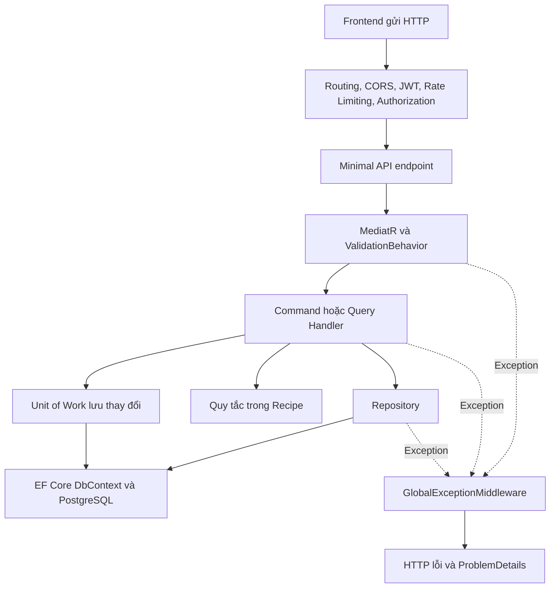

# Báo cáo tổng hợp công việc Chung Thiện Ý — Tuần 1 đến Tuần 7


- **Môn học:** Phát triển ứng dụng web nâng cao.
- **Sinh viên:** Chung Thiện Ý — **2312804**, Nhóm 18.
- **Dự án:** Culinary Blog — ứng dụng chia sẻ công thức nấu ăn.
- **Nhánh làm việc:** `2312804_ChungThienY_nhom18`.
- **Ngày cập nhật:** 27/10/2026. Số liệu tuần 1–5 giữ theo lần tổng hợp 13/10; tuần 6 ở mục 13; tuần 7 ngày 21/10 ở mục 14. Phần áp dụng kỹ thuật tham khảo ở mục 15; đợt hoàn thiện yêu cầu Auth, hồ sơ và giao diện theo xác nhận bổ sung ở mục 16.
- **Căn cứ:** [SRS v1.0.0, 71 trang](SRS_Culinary_Blog_v1.0.0.pdf), [phân công chi tiết](phan_cong_chi_tiet_theo_buoi.md), [quyết định giải quyết mâu thuẫn SRS](phan-tich-mau-thuan-SRS-v1.0.0.md) và mã nguồn hiện có.

Tài liệu này gộp nội dung báo cáo Recipe tuần 1–5, yêu cầu tối thiểu tuần 5, phần frontend/tìm kiếm tuần 6 và Welcome Email/health check MinIO tuần 7. Mục đích là giải thích **đã thực hiện gì, vì sao cần thực hiện, mã nằm ở đâu và đã kiểm chứng bằng cách nào**, để thuận tiện đọc hiểu và trình bày phần việc được phân công. Đợt hoàn thiện bổ sung theo yêu cầu ngày 27/10 được ghi riêng tại mục 16. Báo cáo Word: [Lab6_2312804_ChungThienY.docx](Lab6_2312804_ChungThienY.docx), [Lab7_2312804_ChungThienY.docx](Lab7_2312804_ChungThienY.docx). Các bản Lab đã nộp trước đó được giữ nguyên.

## 1. Phạm vi và cách đọc báo cáo

Theo bảng phân công cập nhật, từ tuần 3 nhóm chuyển sang giao module cho từng người. Phần nghiệp vụ chính của Chung Thiện Ý là **Recipe Create/Read, Update và Publish**. Không lấy lại các chức năng từng xuất hiện trong bảng chia FR cũ nhưng sau đó đã chuyển cho thành viên khác.

Phần hạ tầng dùng chung và frontend để đáp ứng yêu cầu tối thiểu tuần 5 được bổ sung theo xác nhận của sinh viên. Phạm vi này gồm CORS, Rate Limiting, Authentication/Authorization, OpenAPI/Scalar, API versioning, môi trường, thư viện và TS types.

Trong báo cáo:

- **Dùng lại** nghĩa là sử dụng nền tảng đã có của nhóm, không nhận toàn bộ công viết nền tảng đó thành phần việc cá nhân.
- **Hoàn thiện/điều chỉnh** nghĩa là bổ sung hoặc sửa mã hiện có để phần việc chạy đúng và khớp đặc tả đã thống nhất.
- Các mục được sắp theo **nội dung phân công từng tuần**, không phải xác nhận rằng mọi thay đổi được viết đúng vào ngày diễn ra buổi học đó. Báo cáo cũng không thay thế bằng chứng tham dự họp.
- **“Hoàn thành tất cả API endpoints” của tuần 4 được đối chiếu với toàn bộ endpoint thuộc phần việc cá nhân được giao đến tuần 4.** Không đồng nghĩa với hoàn thành mọi endpoint của cả nhóm hoặc chức năng được giao cho các tuần sau.

### 1.1. Tổng quan theo tuần

| Tuần | Nội dung của Chung Thiện Ý | Kết quả trong dự án |
|---|---|---|
| 1 | Đọc, phân tích Auth, Category, Recipe và xác định phạm vi | Nắm quan hệ dữ liệu, quyền truy cập, quy tắc Recipe và các mâu thuẫn SRS cần áp dụng |
| 2 | Không có dòng giao riêng cho Chung Thiện Ý trong bảng cập nhật | Dùng nền tảng Clean Architecture, DbContext, Identity/JWT và DI do nhóm cung cấp |
| 3 | Recipe Create/Read; exceptions; repository và Unit of Work; ít nhất 2 endpoint; middleware toàn cục | Có 3 endpoint cơ bản và thêm đọc theo slug; sử dụng repository riêng, Unit of Work chung và ProblemDetails |
| 4 | Hoàn thành toàn bộ endpoint được giao; Recipe Update, RowVersion, slug | Hoàn thiện PUT; đủ 5 thao tác API đến tuần 4; kiểm tra quyền, dữ liệu đầu vào và xung đột 409 |
| 5 | Publish Recipe và các yêu cầu tối thiểu bổ sung | Thêm Publish; hoàn thiện bảo mật, đặc tả/versioning API, frontend, thư viện và TS types |
| 6 | FR-SRCH-002 và yêu cầu tối thiểu frontend đã được xác nhận | Bộ lọc tìm kiếm kết hợp; tiện ích API/lỗi; Radix Dialog; store; trang Search responsive; component và layout dùng chung. Chi tiết mục 13 |
| 7 | FR-JOB-001 Welcome Email và bổ sung health check MinIO | Hangfire enqueue sau khi lưu đăng ký, MailKit/SMTP qua MailHog, retry và kiểm tra bucket MinIO. Chi tiết mục 14 |

### 1.2. Kết quả kiểm chứng tuần 1–5 tại ngày 13/10/2026

| Kiểm tra | Kết quả gần nhất |
|---|---|
| Toàn bộ project `CulinaryBlog.UnitTests`, gồm kiểm thử HTTP | **83/83 đạt** |
| Trong số trên: kiểm thử bảo mật, versioning, OpenAPI | **17/17 đạt** |
| Chạy lại bộ HTTP Recipe trên PostgreSQL 16 và Redis 7 tạm | **14/14 đạt** |
| Kiểm thử frontend về demo, schema, callback URL | **5/5 đạt** |
| TypeScript strict và ESLint toàn frontend | **Đạt** |
| Build frontend Production, có standalone và Edge middleware | **Đạt** |
| Kiểm tra Auth trên bản standalone Production | **Đạt với backend giả lập localhost** |

**Cách hiểu số liệu:** 17 ca bảo mật nằm trong 83 ca backend; 14 ca PostgreSQL/Redis là chạy lại các ca HTTP Recipe với hệ lưu trữ thật. Không cộng các con số này thành số ca kiểm thử độc lập mới. Các ca vốn có của module khác trong project test cũng không được tính thành công việc cá nhân.

## 2. Tuần 1 — Phân tích yêu cầu và hiểu kiến trúc

### 2.1. Những yêu cầu đã phân tích

Đã đọc SRS gốc đủ 71 trang để hiểu toàn cảnh, tập trung vào Auth ở mục 3.1, Category ở mục 3.2 và Recipe ở mục 3.3. Phần Recipe được đối chiếu với FR-RCP-001–005 ở trang 27–32, mô hình dữ liệu trang 54–57 và API trang 63–64.

| Module | Nội dung cần hiểu | Liên quan đến phần Recipe |
|---|---|---|
| Auth | Đăng nhập, JWT, refresh token, vai trò Author/Admin | API cần biết ai đang gọi để lấy AuthorId và kiểm tra quyền |
| Category | Danh mục và quan hệ với Recipe | Tạo hoặc đổi danh mục phải kiểm tra CategoryId tồn tại |
| Recipe | Trạng thái, dữ liệu cơ bản, bước, nguyên liệu, quyền đọc/sửa | Là phần nghiệp vụ cá nhân triển khai từ tuần 3 |

Ví dụ: client không được tự gửi `authorId` để nhận quyền sở hữu. Người dùng đăng nhập nào tạo công thức thì backend lấy định danh người đó từ JWT. Nếu client sửa ID công thức trên URL sang công thức của người khác, backend vẫn phải kiểm tra chủ sở hữu.

### 2.2. Quan hệ dữ liệu

`Recipe` là thực thể trung tâm, chứa thông tin công thức và liên kết các dữ liệu liên quan:

- Một Recipe thuộc một **Category** và một **Author**.
- Một Recipe có nhiều **RecipeStep**, **RecipeIngredient**, **RecipeImage**.
- **RecipeNutrition** là owned entity: EF Core quản lý như một phần của Recipe; các cột dinh dưỡng nằm trong bảng Recipes.
- `IsDeleted` phục vụ xóa mềm. Global query filter loại các bản ghi đã xóa mềm khỏi truy vấn thông thường.
- `RowVersion` dùng phát hiện dữ liệu đã thay đổi; `PublishedAt` ghi thời điểm xuất bản.

“Aggregate root” ở đây nghĩa là Recipe đóng vai trò gốc của một nhóm dữ liệu liên quan. Khi tạo công thức kèm bước và nguyên liệu, handler có thể tạo cả nhóm rồi lưu một lần. Quy tắc có được xuất bản hay chưa được đặt trong `Recipe.Publish()`.

### 2.3. Vai trò của bốn tầng backend

| Tầng | Trách nhiệm | Ví dụ trong phần việc |
|---|---|---|
| Domain | Mô hình và quy tắc nghiệp vụ, không xử lý HTTP | Recipe, enum trạng thái, `Recipe.Publish()`, lỗi thiếu điều kiện Publish |
| Application | Điều phối một yêu cầu của ứng dụng | Command/Query Handler, validator, kiểm tra quyền sở hữu, DTO |
| Infrastructure | Cách truy cập database và dịch vụ bên ngoài | EF Core, RecipeRepository, DbContext, PostgreSQL, Redis |
| API | Nhận HTTP và trả phản hồi | Minimal API, JWT/policy, CORS, rate limiter, middleware |

Frontend Next.js gọi API thông qua các hook và `lib/api-client.ts`. Backend sử dụng CQRS: **Command** xử lý thay đổi dữ liệu; **Query** xử lý đọc dữ liệu. MediatR chuyển request đến đúng handler, còn FluentValidation kiểm tra dữ liệu đầu vào.



Luồng thành công trả DTO cho client. Khi có exception, lỗi được truyền ngược lên middleware thay vì mỗi endpoint tự tạo một kiểu phản hồi lỗi khác nhau.

### 2.4. Các quyết định giải quyết mâu thuẫn SRS đã áp dụng

| Quyết định | Hành vi được áp dụng | Lý do |
|---|---|---|
| #5 — concurrency | RowVersion cũ trả **409 Conflict** | Đây là xung đột với trạng thái hiện tại của tài nguyên |
| #6 — slug | Trùng slug tự thêm `-2`, `-3`… | Cho phép nhiều công thức có cùng tiêu đề |
| #7 — Publish | Cần ít nhất một bước **và** một nguyên liệu còn hiệu lực | Công thức công khai phải đủ nội dung cơ bản |
| #10 — Instructions | Trường legacy tùy chọn | Nội dung hướng dẫn chi tiết được biểu diễn bằng Steps |
| #3/#4 — cache | Dùng Output Cache/Redis sẵn có của nhóm, xóa tag liên quan sau mutation | Tránh giữ phản hồi cũ sau khi dữ liệu thay đổi |

`CookTime = 0` vẫn hợp lệ theo bảng Recipe trang 55 vì có món không cần nấu. SRS gốc gộp Publish/Unpublish trong FR-RCP-005, nhưng phân công cập nhật của Chung Thiện Ý tuần 5 chỉ yêu cầu **Publish**.

## 3. Tuần 2 — Sử dụng nền tảng chung của nhóm

Bảng cập nhật tuần 2 không giao riêng nhiệm vụ cho Chung Thiện Ý; các công việc khởi tạo backend và Auth cơ bản được giao cho Mai Văn Quang. Phần Recipe sử dụng lại nền tảng đó:

- Solution gồm Domain, Application, Infrastructure và API.
- Entity nền tảng, cấu hình EF Core, `CulinaryBlogDbContext` và cơ chế DI.
- Identity/JWT cung cấp tài khoản, định danh và role.
- `IRepository<T>`, `RepositoryBase<T>` và `IUnitOfWork` dùng chung.
- Hạ tầng xử lý exception, logging và các dịch vụ đã có của nhóm.

Điểm cần trình bày: **không viết lại DbContext hoặc hệ thống đăng nhập chỉ để phục vụ Recipe**. Phần cá nhân kết nối đúng với các interface và service đã có. Các điều chỉnh bảo mật/frontend dùng chung được trình bày riêng ở tuần 5 vì đã được duyệt bổ sung.

## 4. Tuần 3 — Recipe Create/Read và bốn yêu cầu tối thiểu

### 4.1. Bảng đối chiếu yêu cầu của giảng viên

| Yêu cầu tuần 3 | Cách đáp ứng trong phần Recipe | Bằng chứng mã nguồn |
|---|---|---|
| Cài đặt các lớp domain exceptions/lỗi nghiệp vụ | Có lỗi Recipe không tồn tại; lỗi dữ liệu và quyền dùng exception chung; các tuần tiếp theo bổ sung lỗi concurrency và Publish | [RecipeNotFoundException](../src/CulinaryBlog.Application/Common/Exceptions/RecipeNotFoundException.cs), [thư mục exception chung](../src/CulinaryBlog.Application/Common/Exceptions), [exception của Domain](../src/CulinaryBlog.Domain/Common/Exceptions/RecipePublishIncompleteException.cs) |
| Repository và Unit of Work | Repository riêng của Recipe kế thừa repository chung; lưu qua Unit of Work dùng cùng DbContext | [IRecipeRepository](../src/CulinaryBlog.Domain/Interfaces/IRecipeRepository.cs), [RecipeRepository](../src/CulinaryBlog.Infrastructure/Persistence/Repositories/RecipeRepository.cs), [IUnitOfWork](../src/CulinaryBlog.Domain/Interfaces/IUnitOfWork.cs) |
| Ít nhất 2 API endpoints/thành viên | Có POST tạo, GET danh sách, GET theo ID; thêm GET theo slug để frontend sử dụng | [RecipesEndpoints](../src/CulinaryBlog.API/Endpoints/RecipesEndpoints.cs) |
| Middleware bắt lỗi và trả ProblemDetails toàn cục | Dùng middleware chung, ánh xạ exception nghiệp vụ Recipe thành HTTP status và mã lỗi | [GlobalExceptionMiddleware](../src/CulinaryBlog.API/Middleware/GlobalExceptionMiddleware.cs), [Program](../src/CulinaryBlog.API/Program.cs) |

Phần dưới giải thích từng yêu cầu, không chỉ liệt kê tên lớp.

### 4.2. Exception nghiệp vụ là gì và đang đặt ở đâu?

Exception nghiệp vụ biểu diễn một tình huống không thể tiếp tục xử lý theo quy tắc ứng dụng, chẳng hạn không tìm thấy công thức. Dùng lớp riêng giúp middleware phân biệt lỗi bằng **kiểu exception**, không phải so sánh chuỗi thông báo.

Các lớp liên quan trong trạng thái mã nguồn đến cuối tuần 5:

| Lớp | Tầng thực tế | Khi phát sinh | Kết quả HTTP |
|---|---|---|---|
| `RecipeNotFoundException` | Application | Không tìm thấy Recipe theo ID/slug hoặc bản ghi đã bị xóa mềm | 404, `RECIPE_NOT_FOUND` |
| `ValidationException` | Application, dùng chung | Dữ liệu không hợp lệ, danh mục không tồn tại, If-Match thiếu/sai | 422, `VALIDATION_ERROR` và errors theo trường |
| `UnauthorizedException` | Application, dùng chung | Handler cần người dùng đăng nhập nhưng không có định danh hợp lệ | 401, `UNAUTHORIZED` |
| `ForbiddenAccessException` | Application, dùng chung | Người dùng không có quyền sửa tài nguyên | 403, `FORBIDDEN` |
| `RecipeConcurrencyConflictException` | Application, phần Update tuần 4 | RowVersion không khớp hoặc EF phát hiện tranh chấp khi lưu | 409, `RECIPE_CONCURRENCY_CONFLICT` |
| `RecipePublishIncompleteException` | **Domain**, phần Publish tuần 5 | Thiếu bước hoặc nguyên liệu còn hiệu lực | 400, `RECIPE_PUBLISH_INCOMPLETE` |

**Phân biệt tên yêu cầu với vị trí mã:** các lỗi điều phối như không tìm thấy tài nguyên và concurrency đang nằm ở Application. Lỗi vi phạm quy tắc `Recipe.Publish()` nằm ở Domain. Không phải mọi exception đều nằm trong project Domain, và không phải tất cả các lớp trong bảng đều được bổ sung ở tuần 3.

Domain chỉ ném lỗi nghiệp vụ; Domain không biết HTTP 400 hay ProblemDetails. Việc chọn HTTP status thuộc API. Nhờ vậy cùng quy tắc Publish có thể được gọi từ một luồng xử lý khác mà không cần phụ thuộc ASP.NET Core.

### 4.3. Repository giải quyết việc gì?

Repository gom cách đọc/ghi dữ liệu, giúp handler làm việc qua interface thay vì tự gắn với chi tiết EF Core ở mọi nơi.

- [IRepository<T>](../src/CulinaryBlog.Domain/Interfaces/IRepository.cs) khai báo thao tác chung: lấy theo ID, thêm, cập nhật, xóa và truy vấn.
- [RepositoryBase<T>](../src/CulinaryBlog.Infrastructure/Persistence/Repositories/RepositoryBase.cs) thực hiện các thao tác đó bằng DbSet.
- `IRecipeRepository` bổ sung các truy vấn đặc thù của công thức; `RecipeRepository` triển khai chúng.

| Phương thức riêng | Mục đích và cách sử dụng |
|---|---|
| `GetByIdWithDetailsAsync` | Đọc đầy đủ Category, Author, Steps, Ingredients, Images để trả trang chi tiết |
| `GetBySlugWithDetailsAsync` | Đọc chi tiết bằng đường dẫn dễ đọc, ví dụ `pho-bo` |
| `SlugExistsAsync` | Kiểm tra slug đã được sử dụng, kể cả bản ghi xóa mềm, để tránh tái sử dụng nhầm URL |
| `SetOriginalRowVersion` | Đặt token client đã đọc vào OriginalValue của EF khi cập nhật |
| `GetByIdForPublishingAsync` | Truy vấn có tracking, Include Steps/Ingredients cho Publish; bổ sung khi hoàn thiện tuần 5 |

Repository hiện còn có phương thức Search của module đã có trong nhóm. Báo cáo không nhận phần cài đặt Search đó thành công việc cá nhân.

**Tracking và AsNoTracking:** truy vấn chỉ đọc dùng `AsNoTracking()` để EF không theo dõi thay đổi không cần thiết. Truy vấn dùng để sửa/Publish cần tracking để Unit of Work lưu thay đổi trạng thái. Đây là hai mục đích khác nhau, nên không dùng một phương thức bất kỳ thay cho tất cả.

### 4.4. Unit of Work giải quyết việc gì?

Repository tiếp nhận thay đổi, còn Unit of Work quyết định lúc lưu các thay đổi đó. Trong dự án, [CulinaryBlogDbContext](../src/CulinaryBlog.Infrastructure/Persistence/CulinaryBlogDbContext.cs) triển khai `IUnitOfWork`; `SaveChangesAsync()` của EF Core thực hiện việc lưu.

Ví dụ tạo công thức:

1. Tạo Recipe với trạng thái Draft.
2. Thêm các Step và Ingredient vào collection của Recipe.
3. Gọi `recipeRepository.AddAsync(recipe)` để EF theo dõi cả nhóm dữ liệu.
4. Gọi `unitOfWork.SaveChangesAsync()` **một lần** để lưu aggregate.

Với PostgreSQL, các thay đổi trong lần SaveChanges đó được lưu trong transaction: thành công cùng nhau hoặc thất bại cùng nhau. Tránh tình trạng đã có công thức nhưng mới lưu được một phần nguyên liệu do tách lưu không hợp lý.

DI đăng ký repository và Unit of Work dùng **cùng instance DbContext trong request**. Nếu mỗi bên dùng một DbContext khác nhau, Unit of Work có thể không thấy các thay đổi repository đang theo dõi.

Interface còn có `ExecuteInTransactionAsync` cho trường hợp cần nhiều lần SaveChanges trong một transaction. Đây là nền tảng dùng chung; luồng Create Recipe hiện chỉ cần một SaveChanges. InMemory dùng trong test không thay thế được việc kiểm chứng transaction/trigger của PostgreSQL.

### 4.5. Các endpoint Create/Read đã hoàn thiện

| Endpoint | Hành vi | Quyền |
|---|---|---|
| `POST /api/v1/recipes` | Tạo Recipe Draft, có thể kèm bước/nguyên liệu | Author hoặc Admin |
| `GET /api/v1/recipes` | Trả danh sách phân trang và meta | Published công khai; người đăng nhập được xem thêm theo quyền |
| `GET /api/v1/recipes/{id}` | Đọc chi tiết theo Guid | Published công khai; Draft/Archived chỉ owner hoặc Admin |
| `GET /api/v1/recipes/{slug}` | Đọc chi tiết bằng slug cho trang frontend | Cùng quy tắc với đọc theo ID |

Như vậy tuần 3 có **3 endpoint cơ bản theo phân công**, vượt mức tối thiểu 2 endpoint/thành viên; endpoint đọc theo slug là phần hỗ trợ frontend bổ sung. `/{id:guid}` và `/{slug}` được định tuyến riêng.

**Luồng Create** nằm chủ yếu trong [CreateRecipeCommandHandler](../src/CulinaryBlog.Application/Features/Recipes/Commands/CreateRecipe/CreateRecipeCommandHandler.cs): kiểm tra người dùng → kiểm tra Category → sinh slug duy nhất → tạo aggregate Draft → lưu qua Unit of Work → xóa cache tag recipes → đọc lại DTO, có RowVersion do DB sinh.

**Luồng Read:** [GetRecipesQueryHandler](../src/CulinaryBlog.Application/Features/Recipes/Queries/GetRecipesQueryHandler.cs) áp dụng quyền trước khi phân trang. Khách chỉ thấy Published; Author thấy Published và Draft/Archived của mình; Admin thấy mọi Recipe chưa xóa mềm. Đọc chi tiết sai quyền trả 403, không có tài nguyên trả 404.

### 4.6. Các ràng buộc dữ liệu đã đồng bộ

| Trường | Quy tắc |
|---|---|
| Title | Ít nhất 5 ký tự sau khi bỏ khoảng trắng đầu/cuối; tối đa 200 ký tự |
| Description | Bắt buộc; tối đa 2.000 ký tự |
| CategoryId | Guid hợp lệ và phải tồn tại, chưa xóa mềm; không tồn tại trả 422 theo trường |
| PrepTime | Lớn hơn 0 |
| CookTime | Lớn hơn hoặc bằng 0 |
| Servings | Lớn hơn 0 |
| Difficulty | Giá trị enum hợp lệ: Easy, Medium, Hard, Expert |
| Instructions | Tùy chọn; tối đa 10.000 ký tự |
| Steps/Ingredients khi tạo | Draft được phép chưa đủ; nếu gửi dữ liệu thì kiểm tra trường và thứ tự theo validator |

Validator backend là nơi quyết định cuối cùng; frontend dùng Zod để báo lỗi sớm. Không được chỉ kiểm tra ở giao diện vì người dùng có thể gọi API trực tiếp.

### 4.7. Middleware toàn cục và ProblemDetails

`GlobalExceptionMiddleware` bao quanh phần xử lý phía sau bằng try/catch. Handler chỉ ném exception; middleware chọn status, mã lỗi, thông báo và định dạng JSON thống nhất.

Ví dụ lỗi Publish thiếu dữ liệu, được bổ sung ở tuần 5 nhưng dùng cùng cơ chế middleware:

```json
{
  "type": "RECIPE_PUBLISH_INCOMPLETE",
  "title": "Công thức chưa đủ điều kiện để xuất bản",
  "status": 400,
  "detail": "Công thức phải có ít nhất 1 bước thực hiện và 1 nguyên liệu để xuất bản.",
  "instance": "/api/v1/recipes/<id>/publish"
}
```

Ví dụ lỗi đầu vào có thêm `errors`, như `"errors": { "Title": ["Tên công thức phải có ít nhất 5 ký tự."] }`. Response có Content-Type `application/problem+json`. Lỗi ngoài dự kiến được log ở server, trả 500 với thông báo chung, không trả stack trace cho client.

Không cần thêm try/catch trùng lặp vào mọi endpoint. JWT challenge/forbidden và rate limiter không nhất thiết phát sinh exception; ở tuần 5 chúng được cấu hình trả ProblemDetails ngay trong callback riêng để vẫn thống nhất định dạng.

## 5. Tuần 4 — Hoàn thành API được giao, Update, concurrency và slug

### 5.1. Đối chiếu yêu cầu “tất cả API endpoints”

Đến tuần 4, phần phân công cá nhân gồm Create/Read từ tuần 3 và **Update** ở tuần 4. Có đủ **5 thao tác API**: POST tạo, GET danh sách, GET theo ID, GET theo slug và PUT cập nhật.

Endpoint mới của tuần 4 là **`PUT /api/v1/recipes/{id}`**. Luồng đã có request, command, validator, handler, repository, lưu dữ liệu, phân quyền, xử lý concurrency và phản hồi; không chỉ khai báo route rồi để trống xử lý.

Các endpoint CRUD nguyên liệu/bước/ảnh được giao cho Hồ Quốc Tiến; Archive, Delete/Purge và Sitemap thuộc phần việc khác. Không lấy những endpoint đó để tính vào số endpoint cá nhân hoặc tuyên bố toàn bộ API của cả nhóm đã hoàn tất.

### 5.2. Luồng cập nhật

Mã chính: [UpdateRecipeCommandHandler](../src/CulinaryBlog.Application/Features/Recipes/Commands/UpdateRecipe/UpdateRecipeCommandHandler.cs) và [ConcurrencyTokenHelper](../src/CulinaryBlog.Application/Common/Helpers/ConcurrencyTokenHelper.cs).

1. Đọc và giải mã header If-Match thành RowVersion.
2. Tải Recipe có tracking; không có thì ném RecipeNotFoundException.
3. Kiểm tra quyền owner/Admin bằng [RecipeAuthorization](../src/CulinaryBlog.Application/Common/Authorization/RecipeAuthorization.cs).
4. So RowVersion client gửi với phiên bản hiện tại; cũ thì trả 409 sớm.
5. Nếu đổi Category, kiểm tra danh mục mới tồn tại; sai thì trả 422.
6. Cập nhật trường được gửi; xử lý slug theo trạng thái.
7. Đặt RowVersion client thành OriginalValue để EF tiếp tục kiểm tra khi lưu.
8. SaveChanges; nếu EF báo DbUpdateConcurrencyException thì chuyển thành lỗi Recipe 409.
9. Xóa cache liên quan và đọc lại DTO với RowVersion mới.

Theo hợp đồng hiện có của dự án, PUT nhận các trường tùy chọn: trường không gửi hoặc null giữ giá trị cũ. Không nên suy ra rằng mọi API PUT ở hệ thống khác đều có cùng cách cập nhật này.

### 5.3. Vì sao cần RowVersion và If-Match?

Giả sử hai người cùng mở bản công thức phiên bản A:

| Bước | Người thứ nhất | Người thứ hai |
|---|---|---|
| 1 | Đọc Recipe, giữ token A | Đọc Recipe, giữ token A |
| 2 | Gửi PUT kèm If-Match A; lưu thành công | Vẫn đang chỉnh bản cũ |
| 3 | Database sinh token B | Gửi PUT kèm If-Match A |
| 4 | Dữ liệu mới được giữ lại | Nhận 409, cần tải lại trước khi sửa |

Nếu không có concurrency check, lần lưu sau có thể ghi đè dữ liệu mới mà người thứ hai chưa nhìn thấy. **RowVersion là phiên bản bản ghi, không phải token đăng nhập.** Trong dự án, PostgreSQL `touch_row()` sinh token bytea 8 byte; API trả dưới dạng Base64. C# production không tự tạo token này.

Kiểm tra sớm bằng so sánh token giúp báo lỗi nhanh. Đặt OriginalValue cho EF bảo vệ thêm trường hợp một request khác lưu xen vào sau bước kiểm tra sớm nhưng trước SaveChanges.

If-Match thiếu, sai Base64, sai độ dài hoặc wildcard `*` bị từ chối bằng 422. Token hợp lệ về định dạng nhưng đã cũ trả 409. Đây là hai loại lỗi khác nhau.

### 5.4. Slug và đường dẫn ổn định

Slug là phần đường dẫn dễ đọc, ví dụ tiêu đề “Phở bò” tạo slug `pho-bo`. Nếu đã tồn tại, lần tạo tiếp theo nhận `pho-bo-2`, rồi `pho-bo-3`… Không bắt người dùng đổi tiêu đề chỉ vì có công thức trùng tên.

- Với Draft, đổi tiêu đề có thể sinh slug mới và kiểm tra trùng.
- Với Recipe đang Published, đổi tiêu đề giữ slug hiện tại để không làm hỏng đường dẫn công khai.
- Kiểm tra slug tính cả bản ghi xóa mềm, tránh tái sử dụng nhầm một URL đã có.

Đã kiểm thử tạo trùng tiêu đề, đổi slug của Draft, giữ slug khi sửa Published và từ chối RowVersion cũ. Không suy rộng kết quả này thành kiểm thử tải đồng thời cho mọi tình huống tranh chấp unique slug.

## 6. Tuần 5 — Publish Recipe

### 6.1. Endpoint và quy tắc

Endpoint **`PATCH /api/v1/recipes/{id}/publish`** gọi [PublishRecipeCommandHandler](../src/CulinaryBlog.Application/Features/Recipes/Commands/PublishRecipe/PublishRecipeCommandHandler.cs). Endpoint yêu cầu Author/Admin; handler kiểm tra tiếp quyền sở hữu.

Quy tắc trong [Recipe.Publish()](../src/CulinaryBlog.Domain/Entities/Recipe.cs): cần ít nhất **một Step chưa xóa mềm và một Ingredient chưa xóa mềm**. Thiếu một trong hai thì ném RecipePublishIncompleteException với thông báo nêu rõ phần thiếu.

Khi đủ dữ liệu, Recipe chuyển sang Published và ghi PublishedAt nếu chưa có. Gọi lại khi đã Published giữ nguyên thời điểm xuất bản; handler không SaveChanges hoặc xóa cache thêm lần nữa. Cách gọi lặp không gây thay đổi thêm này được gọi là **idempotent** trong ngữ cảnh thao tác hiện tại.

### 6.2. Lỗi đã phát hiện và sửa

Handler trước đó dùng `GetByIdAsync`, chỉ tải Recipe mà không Include Steps/Ingredients. Trong một request mới, các collection này có thể rỗng dù database đã có dữ liệu, khiến Publish bị từ chối sai.

Đã bổ sung `GetByIdForPublishingAsync` để tải aggregate có tracking và Include phần con. Domain kiểm tra cả cờ IsDeleted; Unit of Work lưu trạng thái mới. Kiểm thử xóa ChangeTracker sau khi seed dữ liệu để các navigation có sẵn từ bước seed không che giấu lỗi thiếu Include.

Handler cũng chuyển lỗi concurrency khi lưu thành 409 và đọc lại DTO sau khi lưu. Không triển khai thêm endpoint Unpublish.

### 6.3. Xóa cache đúng dữ liệu bị ảnh hưởng

| Thao tác thành công | Tag backend được xóa |
|---|---|
| Create | `recipes` |
| Update | `recipes`, `recipe-{id}`, `search`, `categories` |
| Publish có thay đổi trạng thái | `recipes`, `recipe-{id}`, `search`, `categories` |
| Publish lặp khi đã Published | Không lưu lại hoặc xóa cache thêm |

Ví dụ: Category list có `recipeCount`. Publish làm số công thức công khai tăng, nên chỉ xóa cache Recipe sẽ chưa đủ; cần xóa cache Category. Search cũng cần được làm mới để công thức vừa xuất bản xuất hiện ngay.

Đây là sử dụng hạ tầng Output Cache/Redis sẵn có, không viết lại Search hoặc Category. Policy RecipeDetail đã được nhóm khai báo, nhưng việc gắn cache cho GET theo slug thuộc phân công tuần 6, chưa được thực hiện thêm trong phạm vi này. Cache backend HTTP và cache giao diện TanStack Query có mục đích khác nhau.

## 7. Tuần 5 — Năm yêu cầu tối thiểu về hạ tầng và frontend

### 7.1. CORS, Rate Limiting, Authentication/Authorization

Mã cấu hình tập trung tại [ApiSecurityExtensions](../src/CulinaryBlog.API/Extensions/ApiSecurityExtensions.cs), policy tại [AuthorizationPolicies](../src/CulinaryBlog.API/Extensions/AuthorizationPolicies.cs), thứ tự middleware tại Program.

**CORS:** frontend thường chạy ở `http://localhost:3000`, API ở cổng khác. Trình duyệt cần được API cho phép origin frontend. Cấu hình đọc Cors:AllowedOrigins, từ chối wildcard và giá trị origin không hợp lệ; cho phép các method cần thiết cùng Authorization, Content-Type, Accept, If-Match, X-Correlation-ID. Trình duyệt được đọc thêm Retry-After, ETag, X-Correlation-ID, api-supported-versions.

CORS kiểm soát truy cập chéo origin của trình duyệt, **không thay thế đăng nhập và phân quyền**. Client ngoài trình duyệt vẫn cần JWT và phải qua các policy của API.

**Authentication:** JWT chỉ nhận HS256, kiểm tra issuer, audience, chữ ký và thời hạn; secret tối thiểu 32 byte, đặt qua User Secrets/biến môi trường. JWT thiếu, sai hoặc hết hạn trả 401 ProblemDetails và WWW-Authenticate: Bearer.

**Authorization:** policy yêu cầu đã xác thực rồi kiểm tra role. AuthorPolicy cho Author/Admin; AdminPolicy chỉ cho Admin. Với sửa/Publish Recipe, kiểm tra thêm owner ở Application. Nhóm Files được bảo vệ bằng Author/Admin để không cấp URL upload khi chưa xác thực. Thiếu quyền trả 403 ProblemDetails.

**Rate Limiting:** hạn chế số request trong một khoảng thời gian, tránh một nguồn gửi quá nhiều yêu cầu vào API.

| Nhóm | Giới hạn | Cách chia ngân sách |
|---|---|---|
| API | 100 yêu cầu/phút | Theo user ID đã xác thực; khách theo IP kết nối |
| Auth | 10 yêu cầu/phút | Theo IP, dùng chung giữa các endpoint /auth/* |
| Health/preflight | Không dùng ngân sách API như request nghiệp vụ | Giữ health check và preflight hoạt động |

Vượt giới hạn trả **429 RATE_LIMIT_EXCEEDED**, kèm Retry-After theo giây và ProblemDetails; không xếp hàng. Đổi endpoint Auth không tạo ngân sách mới để lách giới hạn. Limiter chạy trong tiến trình API, chưa triển khai ngân sách dùng chung cho nhiều replica. IP là địa chỉ kết nối thực; không tin X-Forwarded-For tùy ý, triển khai qua proxy cần cấu hình trusted proxy riêng.

Thứ tự chính: **exception → routing → CORS → authentication → rate limiter → authorization → output cache**. Authentication xác định người dùng trước khi limiter chia ngân sách theo user; authorization chạy trước khi phục vụ output cache.

### 7.2. Sinh đặc tả API và API versioning

Đã bổ sung `Asp.Versioning.Http` **10.2.0**, dùng [MapV1Group](../src/CulinaryBlog.API/Extensions/ApiVersioningExtensions.cs) cho Auth, Recipe, Recipe Items, Category và Files. Version được đọc từ URL segment, giữ URL `/api/v1/...`, báo api-supported-versions: 1.0 và từ chối version không hỗ trợ. Health check giữ URL không version.

**API version là phiên bản hợp đồng của API**, khác với RowVersion của một bản ghi. API v1 cho biết client đang gọi bộ hợp đồng nào; If-Match cho biết client đang sửa phiên bản dữ liệu nào.

[OpenApiExtensions](../src/CulinaryBlog.API/Extensions/OpenApiExtensions.cs) sinh tài liệu tại `/openapi/v1.json`; giao diện Scalar tại `/scalar/v1`, chỉ mở ở Development. Document mô tả tên/version API, request/response, Bearer, If-Match bắt buộc cho Update Recipe và các lỗi liên quan. Endpoint công khai không bị gắn yêu cầu Bearer nhầm.

[ApiResponseExtensions](../src/CulinaryBlog.API/Extensions/ApiResponseExtensions.cs) dùng typed result với ApiEnvelope/PagedApiEnvelope để OpenAPI nhận biết schema phản hồi. Không chỉ có route trong tài liệu nhưng thiếu cấu trúc data/meta. Tài liệu còn mô tả Retry-After của 429, concurrency 409 và Publish incomplete 400. Production không công khai OpenAPI/Scalar; không thêm API v2.

### 7.3. Môi trường và cấu trúc frontend

Frontend sử dụng Next.js App Router và TypeScript, giữ cấu trúc sẵn có:

```text
frontend/
  app/               Các route, layout, API route của Next.js
  components/        Giao diện, form và thành phần tái sử dụng
  hooks/             Query/mutation gọi dữ liệu
  lib/               API client, tiện ích, schema validation
  types/             Kiểu dữ liệu dùng chung và theo module
  scripts/           Thiết lập môi trường và kiểm tra Production
  tests/             Kiểm thử frontend
  public/            Tài nguyên tĩnh
```

`npm run setup` dùng [setup-env.mjs](../frontend/scripts/setup-env.mjs) tạo `.env.local` từ mẫu và sinh AUTH_SECRET nếu chưa có file. Nếu đã có thì giữ nguyên, không ghi đè secret/cấu hình của sinh viên. [.env.local.example](../frontend/.env.local.example) ghi rõ các biến cần cấu hình.

| Biến | Mục đích |
|---|---|
| NEXT_PUBLIC_API_BASE_URL | URL API dùng bởi trình duyệt, mặc định http://localhost:5000/api/v1; được đóng vào bundle lúc build |
| API_INTERNAL_BASE_URL | URL riêng để Next.js server gọi API, tùy chọn, hữu ích khi chạy Docker |
| AUTH_SECRET | Secret của Auth.js; phải cấp riêng theo môi trường |
| NEXTAUTH_URL / AUTH_URL | URL frontend; dùng domain HTTPS khi triển khai |
| AUTH_DEMO_ENABLED | Cờ bật demo, chỉ có tác dụng ở Development |
| AUTH_GOOGLE_ID / AUTH_GOOGLE_SECRET | Cấu hình Google OAuth tùy chọn |
| Jwt__Secret / Jwt__Issuer / Jwt__Audience | Cấu hình JWT backend qua biến môi trường |
| Cors__AllowedOrigins__0 | Origin frontend mà backend cho phép |

[next.config.ts](../frontend/next.config.ts) giữ output standalone và giới hạn một worker build để giảm lỗi cấp phát/tạo tiến trình khi máy chạy cùng Docker/.NET. Build sử dụng Google Fonts theo cấu hình đã có, cần kết nối tải font; không đổi giao diện/font.

### 7.4. Thư viện cần thiết

| Thư viện | Vai trò |
|---|---|
| Next.js 15, React 19 | Framework và giao diện frontend |
| TypeScript | Kiểm tra kiểu tĩnh, chế độ strict |
| Auth.js v5 / next-auth | Quản lý phiên đăng nhập và kết nối backend Auth |
| TanStack Query | Đọc, cache và làm mới dữ liệu giao diện |
| React Hook Form + Zod | Quản lý form và kiểm tra dữ liệu nhập |
| Tailwind, clsx, tailwind-merge, lucide-react | Styling và thành phần UI |
| ESLint, eslint-config-next | Kiểm tra chất lượng mã |
| @eslint/eslintrc 3.3.7 | Dependency trực tiếp cho cấu hình lint đang sử dụng |
| Asp.Versioning.Http 10.2.0 | Versioning cho backend Minimal API |

Các thư viện chính đã có của nhóm được kiểm tra, dùng lại; package.json và lockfile được đồng bộ. Không nhận toàn bộ việc cài framework ban đầu thành phần cá nhân. Frontend yêu cầu Node.js 20 trở lên; phiên kiểm chứng dùng 24.16.0. Cài theo lockfile bằng `npm ci`. Kiểm thử frontend dùng Node test runner và TypeScript đã có, không thêm test framework.

### 7.5. TS types và đồng bộ với backend

TypeScript types mô tả cấu trúc dữ liệu mà frontend nhận/gửi. Nếu API trả object khác với type khai báo, code có thể đọc sai trường hoặc gửi sai body dù giao diện vẫn hiển thị.

| Tệp | Kiểu dữ liệu được quản lý |
|---|---|
| [common.ts](../frontend/types/common.ts) | ApiEnvelope, PageMeta, PagedResult, ProblemDetails, mã lỗi |
| [user.ts](../frontend/types/user.ts) | UserRole, UserProfile, AuthTokenResponse, input Auth và RegistrationResponse |
| [recipe.ts](../frontend/types/recipe.ts) | Enum dạng chuỗi, RecipeSummary/Detail, Nutrition, các phần con và input tạo/sửa |
| [category.ts](../frontend/types/category.ts) | Category và CategoryInput |
| [file.ts](../frontend/types/file.ts) | Request presigned upload, response URL upload và metadata file |
| [next-auth.d.ts](../frontend/types/next-auth.d.ts) | Khai báo bổ sung Session/User/JWT cho Auth.js |
| [index.ts](../frontend/types/index.ts) | Export tập trung các types của ứng dụng |

Ví dụ: `instructions` của RecipeDetail là `string | null`; trường nullable không được khai là luôn có chuỗi. Guid và ngày giờ JSON được nhận dưới dạng string; RowVersion là string Base64; dinh dưỡng có thể null. RecipeSummary và RecipeDetail được tách vì cấu trúc phản hồi thực tế khác nhau.

TypeScript types không tự kiểm tra JSON ở runtime. Zod/FluentValidation bổ sung việc kiểm tra dữ liệu thật. Đã sửa 8 lỗi TypeScript cũ do form dùng email/userName/fullName không khớp schema account; không tắt strict để bỏ qua lỗi. ESLint bỏ qua .next/out/build sinh tự động để chỉ kiểm tra mã nguồn cần quản lý.

### 7.6. Authentication frontend và demo Development

[auth.config.ts](../frontend/auth.config.ts) chứa callback dùng chung cho Edge, không import filesystem Node. [auth.ts](../frontend/auth.ts) chứa provider phía server; [middleware.ts](../frontend/middleware.ts) dùng cấu hình Edge để bảo vệ dashboard/profile và trang quản trị Category.

Trước khi điều chỉnh, tài khoản local tạo `local-token-*`, không phải JWT backend nên không gọi được API có bảo vệ. Đã tách rõ:

- **Mặc định/Production:** đăng nhập bằng email, xác thực qua backend. Đăng ký chuyển FullName/Email/UserName/Password sang backend, không ghi users.json cục bộ. Mật khẩu tối thiểu 8 ký tự, có chữ hoa, số, ký tự đặc biệt.
- **Demo:** chỉ bật khi NODE_ENV=development **và** AUTH_DEMO_ENABLED=true. Cờ true ở Production vẫn không bật demo; token demo cũ bị loại ngoài chế độ demo. Giao diện báo rõ giới hạn; hook không gửi local-token sang backend.
- Auth.js giữ refresh token trong JWT cookie; session client nhận access token, user và roles. Refresh thất bại thì xóa token/quyền để yêu cầu đăng nhập lại.
- Callback URL bị giới hạn trong ứng dụng. Trang login/register đọc cờ cấu hình lúc chạy. Google chỉ hiện khi đủ Google ID/Secret; chưa kiểm chứng Google với tài khoản ngoài thực tế.

Muốn xem demo, thêm `AUTH_DEMO_ENABLED=true` vào `.env.local`, chạy `npm run dev`. Demo không cấp quyền tạo/sửa/xuất bản dữ liệu backend. Muốn kiểm chứng Recipe cần tài khoản backend thật.

## 8. Các điều chỉnh frontend Recipe và database

### 8.1. Giao diện Recipe đã hoàn thiện

- Wizard gửi đúng tên trường API, không ép Instructions thành bắt buộc và chuyển sang trang chỉnh sửa sau khi tạo.
- Form chỉnh sửa gửi If-Match; Publish hiển thị thông báo thành công hoặc lỗi từ backend. Đã bỏ nút có nhãn Publish nhưng gọi nhầm /unpublish.
- Cache danh sách/chi tiết Recipe phân biệt người dùng, chờ session tải xong trước khi query. Tránh đổi tài khoản nhưng thấy lại dữ liệu nháp của phiên trước.
- Update/Publish làm mới cache Recipe và Category ở giao diện, cùng với việc backend xóa output cache.
- Dashboard dùng pageSize=50 đúng giới hạn API, thay cho 100 gây 422. Thông báo danh sách phản ánh Published và bản nháp/lưu trữ theo quyền; số liệu tổng quan chỉ tính tối đa 50 bản ghi đang tải.

Mã chính: [useRecipes](../frontend/hooks/useRecipes.ts), [RecipeWizardForm](../frontend/components/forms/RecipeWizardForm.tsx), [RecipeEditForm](../frontend/components/forms/RecipeEditForm.tsx).

### 8.2. Instructions nullable và database đang có

Sinh viên xác nhận database được tạo bằng Docker với `db/init/*.sql`. Đã đồng bộ Instructions tùy chọn ở command, DTO, entity, EF configuration, TypeScript type và [SQL khởi tạo](../db/init/02-schema.sql).

Database đã tồn tại cần [script cập nhật cột](../db/patches/recipe-instructions-nullable.sql):

```sql
BEGIN;
ALTER TABLE "Recipes" ALTER COLUMN "Instructions" DROP NOT NULL;
COMMIT;
```

Script giữ nguyên dữ liệu, có thể chạy lại. **Chưa áp dụng vào database hiện có của nhóm**, theo lựa chọn để sinh viên chủ động thực hiện. Chỉ khởi động lại Docker không tự cập nhật cột trong volume đã có; không cần xóa volume hoặc tạo lại dữ liệu.

Migration EF ban đầu và snapshot được giữ làm lịch sử. Không chạy thêm cơ chế quản lý schema khác lên database SQL hiện có khi nhóm chưa thống nhất chuyển đổi.

## 9. Ví dụ để tự kiểm tra và trình bày

### 9.1. Tạo công thức có thể xuất bản

Gửi POST /api/v1/recipes với Authorization: Bearer <JWT thật>. Thay CategoryId bằng Guid có thật; không gửi AuthorId.

```json
{
  "title": "Phở bò gia đình",
  "description": "Công thức phở bò cho bốn người",
  "categoryId": "<GUID danh mục có thật>",
  "prepTime": 20,
  "cookTime": 60,
  "servings": 4,
  "difficulty": "Easy",
  "ingredients": [
    { "name": "Thịt bò", "quantity": 0.5, "unit": "kg", "orderIndex": 0 }
  ],
  "steps": [
    { "stepNumber": 1, "title": "Nấu nước dùng", "description": "Ninh xương với lửa nhỏ." }
  ]
}
```

Kết quả mong đợi: 201, data có id, slug, status Draft và rowVersion. Instructions có thể bỏ qua. Chưa Publish thì khách không được đọc chi tiết bản nháp.

### 9.2. Sửa và tạo tình huống xung đột

1. Lưu rowVersion từ response tạo/đọc.
2. Gửi PUT /api/v1/recipes/{id}, header If-Match chứa token đó, body `{"title":"Phở bò gia đình đặc biệt"}`.
3. Nhận 200 với rowVersion mới.
4. Gửi lại PUT bằng **token cũ**: nhận 409 RECIPE_CONCURRENCY_CONFLICT.

Không tự tạo một token Base64 ngẫu nhiên để cập nhật; phải gửi đúng phiên bản client đã đọc. Thiếu If-Match sẽ nhận lỗi dữ liệu 422.

### 9.3. Xuất bản và kiểm tra quyền đọc

Gửi PATCH /api/v1/recipes/{id}/publish bằng owner hoặc Admin. Nếu có đủ bước/nguyên liệu, nhận 200 và status Published, PublishedAt có giá trị. Khách đọc được công thức đã xuất bản.

Tạo Draft khác thiếu bước hoặc nguyên liệu rồi gọi Publish để nhận 400 với thông báo phần thiếu. Đăng nhập Author khác rồi sửa/Publish công thức không thuộc mình để nhận 403. Gọi Publish lặp trên bản đã Published để kiểm tra PublishedAt/RowVersion không đổi chỉ vì gọi lặp.

### 9.4. Bảng mã lỗi cần nhớ

| Tình huống | HTTP/mã lỗi thực tế |
|---|---|
| JWT thiếu, sai hoặc hết hạn ở endpoint bảo vệ | 401 AUTH_TOKEN_INVALID |
| Sai role hoặc quyền sở hữu | 403 FORBIDDEN |
| Recipe không tồn tại/đã xóa mềm | 404 RECIPE_NOT_FOUND |
| RowVersion đã cũ/tranh chấp khi lưu | 409 RECIPE_CONCURRENCY_CONFLICT |
| Publish thiếu bước/nguyên liệu | 400 RECIPE_PUBLISH_INCOMPLETE |
| Tiêu đề, CategoryId, If-Match hoặc dữ liệu đầu vào sai | 422 VALIDATION_ERROR |
| Vượt ngân sách request | 429 RATE_LIMIT_EXCEEDED, có Retry-After |
| Lỗi ngoài dự kiến | 500 INTERNAL_SERVER_ERROR, không lộ stack trace |

## 10. Kiểm thử đã thực hiện và cách chạy lại

### 10.1. Các nhóm kiểm thử

| Nhóm | Những gì được xác nhận |
|---|---|
| Domain Publish | Đủ/thiếu dữ liệu; phần con xóa mềm; PublishedAt; gọi lặp |
| Handler Publish | Repository tải đủ navigation sau khi clear tracking; owner/Admin; không tồn tại; concurrency; cache |
| HTTP Recipe | Endpoint thật qua Kestrel, MediatR, validator, middleware và JWT; Create/Read/Update/Publish; slug; lỗi theo trường |
| PostgreSQL/Redis | Trigger RowVersion thật; lưu Instructions NULL; script nullable chạy hai lần; cache được tạo trước mutation và làm mới sau mutation |
| Security HTTP | CORS whitelist/If-Match; JWT sai chữ ký/issuer/audience/hết hạn; role; Files; 429; phân vùng limiter; versioning; OpenAPI và Scalar |
| Frontend unit | Demo chỉ ở Development; phân biệt token local; callback URL; schema Production và schema demo |
| Frontend Production | Tắt demo dù cờ=true; login/register đi backend giả lập; session không lộ refresh token; bảo vệ route; users.json không đổi |

Tệp kiểm thử: [RecipePublishTests](../tests/CulinaryBlog.UnitTests/Recipes/RecipePublishTests.cs), [PublishRecipeCommandHandlerTests](../tests/CulinaryBlog.UnitTests/Recipes/PublishRecipeCommandHandlerTests.cs), [RecipeApiTests](../tests/CulinaryBlog.UnitTests/Recipes/RecipeApiTests.cs), [SecurityInfrastructureTests](../tests/CulinaryBlog.UnitTests/Api/SecurityInfrastructureTests.cs), [frontend tests](../frontend/tests/auth-mode.test.mjs).

InMemory chỉ phục vụ kiểm tra logic và mô phỏng token trong test. PostgreSQL dùng chính trigger của dự án. Host test không chạy Program/seeder trên database nhóm. Endpoint đếm Recipe để kiểm tra cache Create chỉ tồn tại trong host test, không được thêm vào API production.

### 10.2. Lệnh chạy lại

Từ thư mục gốc repository:

```powershell
dotnet restore tests/CulinaryBlog.UnitTests/CulinaryBlog.UnitTests.csproj
dotnet test tests/CulinaryBlog.UnitTests/CulinaryBlog.UnitTests.csproj --no-restore --disable-build-servers -m:1 -p:UseSharedCompilation=false
```

Mở Docker Desktop, có sẵn image postgres:16-alpine và redis:7-alpine, rồi chạy:

```powershell
.\test-chung-thien-y-tuan-1-5.ps1
```

[Script PostgreSQL/Redis](../test-chung-thien-y-tuan-1-5.ps1) tạo hai container, cổng ngẫu nhiên và database tạm có tiền tố culinary_recipe_tests_, không dùng volume nhóm; tự dọn trong finally. Test từ chối connection string không mang tên database tạm theo quy tắc này.

Frontend:

```powershell
cd frontend
npm ci
npm run type-check
npm run lint
npm run test
npm run build
npm run test:production-auth
```

[Script Production Auth](../frontend/scripts/test-production-auth.mjs) chạy bản standalone và backend giả lập trên localhost/cổng ngẫu nhiên, tự dọn tiến trình. Kiểm tra này xác nhận kết nối/session frontend; không thay thế kiểm thử JWT thật của backend hoặc đăng nhập Google với tài khoản thực.

Khi triển khai standalone, dùng node .next/standalone/server.js hoặc Dockerfile sẵn có. Cấp secret riêng và cấu hình URL/mạng theo môi trường triển khai; không dùng secret của máy phát triển làm secret phát hành.

## 11. Gợi ý đọc mã và trình bày phần việc

Đọc theo thứ tự: **RecipesEndpoints → command/query → validator → handler → interface repository → repository/DbContext → middleware → test tương ứng**. Với Publish, đọc thêm Recipe.Publish() và exception trong Domain. Với frontend, đọc types → api-client → hook → form.

| Nội dung cần giải thích | Ý chính để trình bày |
|---|---|
| Vì sao có repository và Unit of Work? | Repository thao tác dữ liệu; Unit of Work lưu các thay đổi nhất quán, dùng cùng DbContext |
| Vì sao không trả EF entity trực tiếp? | DTO quy định dữ liệu được công khai, tránh trả navigation/vòng tham chiếu và trường nội bộ |
| Vì sao cần exception riêng? | Nhận biết loại lỗi nghiệp vụ bằng kiểu dữ liệu, middleware ánh xạ thống nhất |
| Vì sao domain không tự trả HTTP 400? | Domain độc lập HTTP; API chịu trách nhiệm chuyển lỗi thành phản hồi |
| Vì sao JWT chưa đủ để cho sửa Recipe? | JWT xác định người gọi; vẫn cần role và quyền sở hữu tài nguyên |
| Vì sao trả 409 khi token cũ? | Có request khác đã thay đổi dữ liệu; client cần tải lại, tránh ghi đè |
| Vì sao Publish phải Include phần con? | Domain cần dữ liệu thật của Steps/Ingredients để kiểm tra điều kiện |
| Vì sao xóa cache Category/Search? | Publish/Update làm thay đổi số công thức công khai và kết quả tìm kiếm |
| Vì sao phải tách demo? | Token demo chỉ dùng giao diện, không phải JWT được backend tin cậy |
| Vì sao types chưa đủ thay validation? | Types kiểm tra lúc phát triển; JSON runtime vẫn cần validator/schema |

Một cách mô tả phần việc khi báo cáo: **“Em phụ trách Recipe từ tạo/đọc ở tuần 3, cập nhật có RowVersion và slug ở tuần 4, đến Publish ở tuần 5. Em dùng repository riêng và Unit of Work chung, đưa lỗi nghiệp vụ qua middleware ProblemDetails. Theo yêu cầu tối thiểu bổ sung tuần 5, em hoàn thiện cấu hình bảo mật, versioning/tài liệu API và đồng bộ môi trường, thư viện, types frontend.”** Khi trình bày cần mở mã và test tương ứng để chứng minh, không chỉ đọc tên công nghệ.

## 12. Giới hạn còn lại và tài liệu tham khảo

- Phạm vi tuần 1–5 không bao gồm Archive, Delete/Purge, Sitemap của thành viên khác. Search filters tuần 6 được trình bày ở mục 13; Welcome Email/MinIO health check tuần 7 được bổ sung ở mục 14. Không triển khai Search sorting/pagination của thành viên khác hoặc deploy/tích hợp toàn hệ thống tuần 8.
- SQL nullable Instructions chưa được áp dụng vào database hiện có của nhóm. Cần chủ động chạy script ở mục 8.2 để database cũ khớp code khi bỏ Instructions.
- NuGet còn cảnh báo NU1902/NU1903 ở các package có sẵn như Microsoft.OpenApi, OpenTelemetry, System.Security.Cryptography.Xml. Chưa nâng đồng loạt dependency; báo cáo không khẳng định đã xử lý hết cảnh báo bảo mật.
- Chưa kiểm chứng toàn bộ ứng dụng qua trình duyệt với database và Google thật; kiểm tra Auth frontend Production dùng backend giả lập. Limiter chưa dùng ngân sách chia sẻ giữa nhiều API replica.
- Không tuyên bố đã đạt coverage 80%, các ngưỡng hiệu năng/cache hit hoặc toàn bộ NFR của hệ thống chỉ dựa trên số test đạt.

Tham khảo cài đặt đã sử dụng:

- [ASP.NET Core Rate Limiting](https://learn.microsoft.com/en-us/aspnet/core/performance/rate-limit?view=aspnetcore-10.0).
- [ASP.NET Core OpenAPI transformers](https://learn.microsoft.com/en-us/aspnet/core/fundamentals/openapi/customize-openapi?view=aspnetcore-10.0).
- [ASP.NET API Versioning — các bản phát hành](https://github.com/dotnet/aspnet-api-versioning/releases).
- [Hướng dẫn frontend của dự án](../frontend/README.md).

## 13. Tuần 6 — Bộ lọc tìm kiếm và nền tảng giao diện

### 13.1. Phạm vi đã được xác nhận

Bảng phân công giao **FR-SRCH-002 – Lọc kết quả tìm kiếm** cho Chung Thiện Ý. Sinh viên đã xác nhận thực hiện chức năng này, phần hạ tầng frontend tối thiểu dưới đây và cập nhật báo cáo. Những thay đổi đi qua endpoint, query và repository dùng chung chỉ nhằm truyền và áp dụng bộ lọc của FR-SRCH-002.

| Nội dung | Trách nhiệm và giới hạn |
|---|---|
| FR-SRCH-002 | Ý: danh mục, độ khó, khoảng phút chuẩn bị/nấu, kết hợp với từ khóa theo AND |
| FR-SRCH-001 | Dùng lại full-text tiếng Việt không dấu đã có của Thịnh |
| FR-SRCH-003 | Không triển khai tham số sort/SortParser của Thịnh; giữ thứ tự ts_rank hiện có |
| FR-SRCH-004 | Không triển khai page/pageSize/totalCount của Tiến; giữ giới hạn 50 |
| Chi tiết Category, cache RecipeDetail | Không nhận hoặc sửa phần việc của Quang trong đợt này |
| Yêu cầu frontend chung | Đã được sinh viên cho phép bổ sung trong phạm vi Search, tiện ích, component và layout dùng chung |
| Tuần 7 trở đi | Không thực hiện thêm nghiệp vụ |

Thay đổi không yêu cầu migration hoặc chỉnh schema, secret, cấu hình Google, cổng Docker hay dữ liệu hiện có. Script kiểm thử tạo database/container tạm có tên riêng và tự dọn; không dùng database của nhóm hoặc LMS.

### 13.2. Sáu yêu cầu tối thiểu được đáp ứng như thế nào?

| Yêu cầu | Phần đã làm mới/hoàn thiện | Phần dùng lại của nhóm |
|---|---|---|
| Tiện ích xử lý lỗi, gọi API | ApiNetworkError; chuẩn hóa phản hồi lỗi sai định dạng; tiện ích đọc/kiểm tra/ghi bộ lọc vào URL; RetryButton tải lại dữ liệu | apiFetch, apiFetchPaged, apiUpload, ApiError, apiErrorMessage |
| Gói thư viện hỗ trợ UI | Cài chính xác @radix-ui/react-dialog 1.3.1 và lockfile; tạo Dialog và dùng thật cho bộ lọc mobile | Tailwind, lucide-react, Button/Card sẵn có; không tuyên bố đã cài shadcn CLI |
| Store quản lý trạng thái | SearchFilterProvider + useReducer/useContext trong search-filter-store.tsx; thao tác change/reset/sync | Auth vẫn theo SessionProvider, dữ liệu server vẫn theo cơ chế sẵn có; không lưu JWT lần nữa |
| Thiết kế giao diện tĩnh | Bố cục Search responsive, khung bộ lọc, thẻ kết quả, trạng thái chưa nhập/rỗng/lỗi/đang tải; đã nối API theo đúng DTO | Màu, font, PageHero, trang blog và các trang nghiệp vụ khác đã có |
| Component dùng chung | Dialog, LoadingState, ErrorState, EmptyState, RetryButton; bổ sung aria-current/nhãn trang cho Pagination | Header, Footer, Pagination, Button, Card, DifficultyBadge |
| Layout chung | Dùng root layout bao Search; bổ sung liên kết bàn phím “Đến nội dung chính” và đích main-content; lưới Search 2 cột desktop, 1 cột mobile | app/layout.tsx, Providers, Header/Footer toàn ứng dụng |

Đây là cách đáp ứng yêu cầu tối thiểu bằng việc hoàn thiện và tái sử dụng nền tảng hiện có, **không nhận toàn bộ giao diện của nhóm là sản phẩm cá nhân**. Store không nhất thiết phải tên auth-store.ts: tên đó trong đề là ví dụ; store Search phù hợp phần việc được giao và tránh tạo hai nguồn trạng thái đăng nhập.

### 13.3. Luồng xử lý bộ lọc từ giao diện đến database

1. Người dùng nhập từ khóa, danh mục, độ khó và khoảng thời gian trong SearchFilters. Các giá trị đang nhập được giữ trong store.
2. Khi nhấn Áp dụng, frontend kiểm tra dữ liệu rồi tạo URL /search?... . URL chỉ chứa bộ lọc đã áp dụng nên có thể tải lại, sao chép hoặc dùng Back/Forward.
3. Server Component của trang Search đọc URL, kiểm tra lại và gọi apiFetch tới GET /api/v1/recipes/search. Giao diện không tự lọc một danh sách 50 món đã tải về.
4. RecipesEndpoints nhận các tham số có kiểu, tạo SearchRecipesQuery và gửi qua MediatR.
5. SearchRecipesQueryValidator chạy qua ValidationBehavior hiện có. Lỗi nghiệp vụ đầu vào được middleware toàn cục chuyển thành ProblemDetails 422.
6. Handler chuyển điều kiện sang RecipeSearchFilters trong Domain, gọi IRecipeRepository. Repository không phụ thuộc DTO hoặc lớp giao diện.
7. PostgreSQL áp dụng điều kiện Published, chưa xóa mềm, khớp từ khóa và tất cả bộ lọc; sau đó mới xếp hạng và giới hạn 50 kết quả.
8. Handler trả RecipeDto trong envelope { data: [...] }. Frontend dùng SearchRecipe đúng cấu trúc này để dựng SearchResults.

Ví dụ: chọn danh mục Món nước, độ khó Easy, chuẩn bị từ 10 đến 20 phút và nấu tối đa 30 phút. Một món phải đáp ứng **đồng thời** tất cả điều kiện mới xuất hiện. Món Easy nhưng mất 60 phút nấu vẫn bị loại.

**Vì sao phải lọc trước LIMIT?** Nếu lấy 50 món liên quan nhất trước rồi mới lọc, 50 món này có thể đều là Hard. Món Easy đúng yêu cầu nhưng xếp sau sẽ bị bỏ sót. Kiểm thử tạo hơn 50 món không phù hợp và nhiều bản nháp có hạng cao để chứng minh món phù hợp vẫn được trả về.

### 13.4. Hợp đồng tham số, dữ liệu và lỗi

| Tham số | Ý nghĩa | Quy tắc |
|---|---|---|
| q | Từ khóa full-text | Giữ cách tìm tiếng Việt không dấu có sẵn; q rỗng trả mảng rỗng ở API. UI yêu cầu ít nhất 2 ký tự trước khi tìm |
| categoryId | Lọc một danh mục | GUID khác GUID rỗng; GUID hợp lệ nhưng không tồn tại trả mảng rỗng |
| difficulty | Độ khó | Easy, Medium, Hard, Expert; API cũng bind được số enum hợp lệ |
| minPrepTime / maxPrepTime | Phút chuẩn bị tối thiểu/tối đa | Số nguyên không âm; có thể chỉ truyền một đầu |
| minCookTime / maxCookTime | Phút nấu tối thiểu/tối đa | Số nguyên không âm; 0 phút hợp lệ cho món không cần nấu |

Các biên đều **bao gồm giá trị bằng**: minCookTime=0&maxCookTime=0 chọn đúng món có CookTime bằng 0. Khi có đủ hai đầu thì min không được lớn hơn max. Bỏ hẳn tham số để không áp dụng điều kiện đó.

Ví dụ truy vấn (thay GUID bằng ID danh mục thật):

~~~http
GET /api/v1/recipes/search?q=pho&categoryId=11111111-1111-4111-8111-111111111111&difficulty=Easy&minPrepTime=10&maxPrepTime=20&minCookTime=0&maxCookTime=30
~~~

- minCookTime=-1, khoảng ngược, difficulty=99 hoặc GUID rỗng: **422 ProblemDetails** có errors.
- Chuỗi không bind được kiểu, như categoryId=abc, difficulty=Impossible, thời gian 1.5 hoặc vượt Int32: **400 do Minimal API binding**. Không mô tả nhầm tất cả lỗi query là 422.
- Không tìm được dữ liệu: **200** và data là mảng rỗng.
- Phản hồi Search hiện chưa có meta. UI hiển thị “N công thức hiển thị”, không coi N là tổng số bản ghi database.
- Khi nhận đủ 50 kết quả, UI thông báo giới hạn đang hiển thị và gợi ý thu hẹp điều kiện.

SQL dùng tham số hóa qua SqlQuery, không ghép trực tiếp nội dung người dùng vào câu lệnh. CAST cho tham số nullable giúp PostgreSQL xác định đúng kiểu GUID/số ngay cả khi người dùng bỏ bộ lọc. Không sửa schema hoặc tạo index mới trong đợt này.

Policy Search hiện có đã SetVaryByQuery("*"), vì vậy các tổ hợp filter có khóa cache khác nhau. Đợt này dùng lại policy và kiểm chứng Redis thực tế, không nhận việc xây dựng toàn bộ cache là phần mới.

### 13.5. Cách tổ chức frontend để dễ đọc và mở rộng

**Tiện ích API/lỗi.** api-client.ts vẫn là nơi gom base URL, query string, token và If-Match. Bổ sung ApiNetworkError giúp phân biệt không kết nối được với HTTP 4xx/5xx. safeParseProblem chỉ lấy trường có đúng kiểu, dùng status HTTP thực và bỏ errors sai cấu trúc; lỗi HTML 502 hoặc JSON null không làm giao diện tiếp tục phát sinh lỗi. AbortError được giữ nguyên để không thông báo nhầm thao tác hủy thành lỗi mạng.

**Kiểu dữ liệu.** SearchRecipe khớp RecipeDto: id, slug, title, description, prepTime, cookTime, servings, difficulty, status, publishedAt. Không ép kết quả Search thành RecipeSummary vì Summary còn có các trường ảnh/tác giả mà API này chưa trả. Thẻ Search dùng biểu tượng và dữ liệu thật; không tạo ảnh hoặc tác giả giả.

**Store.** SearchFilterDraft giữ chuỗi của input, kể cả chuỗi rỗng và "0". Reducer có change để đổi trường, reset để xóa filter nhưng giữ từ khóa và sync để đồng bộ với URL khi điều hướng. Provider được tạo theo màn hình, tránh biến toàn cục dùng chung giữa các request SSR. Desktop và dialog mobile dùng cùng store nên không mất nội dung nháp khi đóng/mở hộp thoại. Store chỉ giữ điều kiện tìm kiếm, không giữ token.

**Bố cục và trạng thái.** Desktop có cột bộ lọc 280px và cột kết quả co giãn; mobile mở bộ lọc bằng dialog. loading.tsx dùng LoadingState; error.tsx là ranh giới lỗi của route và có reset. Trang Search còn phân biệt thiếu từ khóa, bộ lọc sai, không có kết quả và lỗi API. RetryButton gọi router.refresh để thực sự tải lại khi URL không đổi. Nếu danh mục chưa tải được, các bộ lọc còn lại vẫn sử dụng được.

**Khả năng sử dụng bằng bàn phím.** Input/select có label, nhóm thời gian dùng fieldset/legend; lỗi dùng role=alert và tải dùng role=status. Dialog dựa trên Radix để giữ focus bên trong, hỗ trợ Escape và trả focus về nút mở. Root layout có skip link. Pagination sẵn có được thêm aria-current cho trang hiện tại; việc này không bổ sung phân trang cho API Search.

### 13.6. Vì sao chọn cách này? Ưu điểm và hạn chế

| Quyết định | Lý do và ưu điểm | Hạn chế/đánh đổi |
|---|---|---|
| Lọc ở repository trước LIMIT | Database chọn đúng tập giao; tránh tải dữ liệu dư và bỏ sót món phù hợp | Đụng chữ ký Search dùng chung, cần phối hợp merge với Thịnh/Tiến |
| Giữ thứ tự ts_rank và giới hạn 50 | Tôn trọng phân công, không làm thay chức năng sorting/pagination | Chưa thể duyệt quá 50 kết quả; cần tích hợp FR-SRCH-004 sau |
| Radix Dialog + Tailwind hiện có | Có hành vi dialog/focus; giữ phong cách giao diện; không cần chuyển toàn app sang bộ component khác | Tăng dependency và JS client; nhóm vẫn tự xây lớp giao diện bằng Tailwind |
| Context + reducer cho store | Dùng React sẵn có, ít cấu hình, tách state khỏi form và kiểm thử được reducer | Hợp với phạm vi Search; không phải store toàn ứng dụng với persistence/devtools |
| URL giữ filter đã áp dụng | Tải lại/chia sẻ/Back/Forward được; không phải đồng bộ localStorage | Cần parse/validate URL và phân biệt draft với điều kiện đã áp dụng |
| Tái sử dụng layout/component nhóm | Giảm trùng mã, Search thống nhất Header/Footer/màu sắc | Phải ghi đúng nguồn đóng góp; hoàn thiện Search không đồng nghĩa viết lại tất cả trang |
| Test DB tạm và API giả lập cho UI | DB thật xác nhận SQL/cache; UI có dữ liệu ổn định để thử lỗi/rỗng/mobile | Test UI giả lập không thay thế một phiên kiểm thử xuyên suốt với database nghiệp vụ thật |

### 13.7. Mã nguồn chính để mở khi báo cáo

| Phần | Tệp |
|---|---|
| Nhận query params và mô tả OpenAPI | [RecipesEndpoints.cs](../src/CulinaryBlog.API/Endpoints/RecipesEndpoints.cs) |
| Query, handler, validator | [SearchRecipesQuery.cs](../src/CulinaryBlog.Application/Recipes/Queries/SearchRecipes/SearchRecipesQuery.cs), [handler](../src/CulinaryBlog.Application/Recipes/Queries/SearchRecipes/SearchRecipesQueryHandler.cs), [validator](../src/CulinaryBlog.Application/Recipes/Queries/SearchRecipes/SearchRecipesQueryValidator.cs) |
| Hợp đồng bộ lọc và SQL | [RecipeSearchFilters.cs](../src/CulinaryBlog.Domain/Interfaces/RecipeSearchFilters.cs), [RecipeRepository.cs](../src/CulinaryBlog.Infrastructure/Persistence/Repositories/RecipeRepository.cs) |
| Utility và types | [search-filters.ts](../frontend/lib/search-filters.ts), [api-client.ts](../frontend/lib/api-client.ts), [types/search.ts](../frontend/types/search.ts) |
| Store | [search-filter-store.tsx](../frontend/stores/search-filter-store.tsx) |
| UI | [SearchFilters.tsx](../frontend/components/search/SearchFilters.tsx), [SearchResults.tsx](../frontend/components/search/SearchResults.tsx), [Search page](../frontend/app/(public)/search/page.tsx) |
| Component dùng chung | [Dialog.tsx](../frontend/components/ui/Dialog.tsx), [Feedback.tsx](../frontend/components/ui/Feedback.tsx), [RetryButton.tsx](../frontend/components/ui/RetryButton.tsx), [Pagination.tsx](../frontend/components/ui/Pagination.tsx) |
| Layout và trạng thái route | [layout.tsx](../frontend/app/layout.tsx), [loading.tsx](../frontend/app/(public)/search/loading.tsx), [error.tsx](../frontend/app/(public)/search/error.tsx) |
| Kiểm thử | [RecipeSearchApiTests.cs](../tests/CulinaryBlog.UnitTests/Recipes/RecipeSearchApiTests.cs), [search.test.mjs](../frontend/tests/search.test.mjs), [test-week6-search.mjs](../frontend/scripts/test-week6-search.mjs) |

### 13.8. Kết quả kiểm chứng ngày 14/10/2026

| Kiểm tra | Kết quả và cách hiểu |
|---|---|
| Toàn bộ project test backend | **119 đạt, 3 bỏ qua có điều kiện, 0 lỗi; tổng 122**. Ba ca raw SQL/cache cần PostgreSQL/Redis được chạy thật ở dòng dưới |
| HTTP Recipe với PostgreSQL 16/Redis 7 tạm | **30/30 đạt**, gồm 14 ca Recipe cũ và 16 ca Search mới; không cộng lặp vào tổng 122 |
| Search mới | 9 trường hợp validation 422; 4 trường hợp binding 400; 3 ca tích hợp về từng filter/tập giao/biên, lọc trước LIMIT và cache |
| Frontend unit | **13/13 đạt**, gồm 5 ca Auth sẵn có và 8 ca mới về filter/store/API/lỗi |
| TypeScript strict, ESLint | **Đạt** |
| Build Production | **Đạt**; khi tạo một số trang sẵn có có log ECONNREFUSED do backend mặc định chưa chạy, build vẫn kết thúc thành công |
| Trình duyệt | **Đạt trên Edge headless, bản Production**: desktop/mobile, filters, validation, reset, Back/Forward, focus trap/Escape, empty/error/retry; không có lỗi JavaScript runtime hoặc tràn ngang mobile. Backend UI là giả lập |

Ca cache xác nhận request lặp lại lấy dữ liệu đã cache bằng cách thay dữ liệu trực tiếp trong database tạm và không evict. Đổi filter phải cho tập kết quả riêng. Ca lọc trước LIMIT tạo 60 món Hard và 60 bản nháp có hạng cao, vẫn tìm được món Easy phù hợp có hạng thấp.

Lệnh chạy tại thư mục gốc:

~~~powershell
dotnet test .\tests\CulinaryBlog.UnitTests\CulinaryBlog.UnitTests.csproj
powershell -NoProfile -ExecutionPolicy Bypass -File .\test-chung-thien-y-tuan-6.ps1
# Chạy cả Recipe và Search trên database tạm:
powershell -NoProfile -ExecutionPolicy Bypass -File .\test-chung-thien-y-tuan-1-5.ps1
~~~

Lệnh frontend:

~~~powershell
cd frontend
npm ci
npm test
npm run type-check
npm run lint
npm run build
~~~

Script DB cần Docker Desktop và hai image postgres:16-alpine, redis:7-alpine có sẵn. Ba test SQL được đánh dấu bỏ qua rõ ràng khi thiếu biến kết nối tạm; không coi chúng là đã chạy trên EF InMemory. NuGet và npm còn cảnh báo dependency của nền tảng hiện có; đợt này không tự nâng đồng loạt package ngoài phạm vi đã duyệt.

### 13.9. Kiểm thử giao diện và minh chứng

Script UI chạy bản standalone Production trên localhost/cổng ngẫu nhiên, tạo backend giả lập riêng và mở Edge headless bằng playwright-core. Script tự đóng tiến trình; dữ liệu món ăn trong ảnh là **fixture kiểm thử**, không phải bằng chứng dữ liệu nghiệp vụ thật.

Có thể cài công cụ kiểm thử riêng ngoài dependency ứng dụng rồi chạy trong thư mục frontend:

~~~powershell
npm install --prefix "$env:TEMP\culinary-week6-browser" --no-save --package-lock=false --offline=false --no-audit --no-fund playwright-core
$env:CULINARY_PLAYWRIGHT_MODULE_PATH = "$env:TEMP\culinary-week6-browser\node_modules\playwright-core\index.mjs"
node .\scripts\test-week6-search.mjs
Remove-Item Env:CULINARY_PLAYWRIGHT_MODULE_PATH
~~~

Máy cần Microsoft Edge. Kiểm thử đã đạt các thao tác: lọc kết hợp, không gửi API khi khoảng sai, xóa filter, Back/Forward, dialog mobile, focus/Escape, kết quả rỗng, lỗi dịch vụ và Thử lại. Không dùng kết quả này để khẳng định đã kiểm thử Google hoặc mọi luồng của blog.

Ảnh minh chứng: [desktop](minh_chung_tuan_6/search-desktop.png), [bộ lọc mobile](minh_chung_tuan_6/search-mobile.png), [kết quả rỗng](minh_chung_tuan_6/search-empty.png), [lỗi dịch vụ](minh_chung_tuan_6/search-error.png). Các ảnh sử dụng dữ liệu kiểm thử như đã nêu, không chứa thông tin tài khoản thật.

File Word được sinh bằng [build-week6-report.py](../scripts/build-week6-report.py), kế thừa A4 ngang, bảng 4 cột và kiểu trình bày từ Lab 5. Đã kiểm tra cấu trúc ZIP/XML, nội dung và số dòng công việc; chưa xác nhận phân trang bằng việc render trong Microsoft Word trên máy này. File DOCX hiện là tài liệu cục bộ và khớp quy tắc ignore của repository; báo cáo không khẳng định đã commit/push tài liệu.

### 13.10. Gợi ý trình bày và phần cần tích hợp tiếp

Có thể trình bày: **“Tuần 6 em phụ trách FR-SRCH-002. Em truyền danh mục, độ khó và khoảng thời gian qua endpoint/query tới repository. Các điều kiện dùng AND trước khi giới hạn kết quả nên không bỏ sót món phù hợp. Ở frontend em thêm store cho bộ lọc, dùng URL cho trạng thái đã áp dụng, Radix Dialog cho mobile và component loading/error/empty. Em dùng lại Header, Footer, layout và full-text của nhóm. SQL/cache được test trên PostgreSQL/Redis tạm; giao diện được kiểm tra riêng bằng API giả lập.”**

Khi thầy/cô hỏi về phần chưa làm: sắp xếp tùy chọn và phân trang Search thuộc Thịnh/Tiến. API vẫn tối đa 50, chưa có metadata phân trang. Sau khi hai phần đó được nhóm tích hợp, cần cập nhật kiểu response/Search page và kiểm thử tổ hợp filter + sort + page; việc này chưa được tính là hoàn thành trong báo cáo cá nhân hiện tại. Chưa kiểm chứng coverage/hiệu năng quy mô lớn hoặc toàn ứng dụng với Google thật.

Tài liệu đối chiếu: [React useReducer](https://react.dev/reference/react/useReducer), [Radix Dialog](https://www.radix-ui.com/primitives/docs/components/dialog), [EF Core SQL queries và tham số hóa](https://learn.microsoft.com/en-us/ef/core/querying/sql-queries).

## 14. Tuần 7 — Welcome Email bằng Hangfire và health check MinIO

### 14.1. Công việc được giao và phạm vi thực hiện

Chung Thiện Ý phụ trách **FR-JOB-001 – Welcome Email** và bổ sung kiểm tra MinIO vào health endpoints. Công việc bao gồm đưa thư chào mừng vào hàng đợi sau đăng ký, gửi bằng MailKit qua MailHog trong môi trường phát triển, xử lý retry và kiểm tra MinIO khi đánh giá readiness.

Phần thay đổi trong RegisterCommandHandler chỉ phục vụ việc lên lịch thư chào mừng. Email xác nhận và đặt lại mật khẩu tiếp tục sử dụng luồng hiện có. Không thực hiện phần xóa tệp/log file của Thịnh, thumbnail/migration UploadedFiles của Tiến, frontend Auth của Quang hoặc nhiệm vụ tuần 8.

Căn cứ: [phân công tuần 7](phan_cong_chi_tiet_theo_buoi.md), [SRS trang 38–39](SRS_Culinary_Blog_v1.0.0.pdf). SRS quy định Welcome Email là fire-and-forget, retry sau 1, 5 và 30 phút. Việc đưa MinIO vào /health/ready áp dụng theo phân công bổ sung tuần 7 đã được xác nhận.

### 14.2. Luồng xử lý đăng ký và gửi thư

1. Request đăng ký đi qua endpoint, MediatR và validator hiện có.
2. RegisterCommandHandler tạo tài khoản bằng Identity, gán vai trò Author và lưu refresh token.
3. Sau SaveChangesAsync, handler gọi IWelcomeEmailScheduler.Enqueue(user.Id). Interface ở Application; HangfireWelcomeEmailScheduler ở Infrastructure gọi IBackgroundJobClient.Enqueue.
4. Hangfire lưu job vào PostgreSQL theo cấu hình chung của ứng dụng. Request đăng ký trả 201 cùng token; không chờ SMTP gửi thư.
5. Worker tạo WelcomeEmailJob qua DI và đọc tài khoản từ database. Tài khoản không tồn tại, không hoạt động hoặc không có email được bỏ qua và ghi log.
6. MailKitWelcomeEmailSender tạo thư HTML và văn bản thuần, kết nối SMTP và gửi. Trong Development, SMTP trỏ đến MailHog.
7. Khi gửi thành công, Hangfire ghi Succeeded. Khi SMTP lỗi, exception được chuyển cho Hangfire để lên lịch thử lại; job không tự bỏ qua lỗi gửi thư.

Chỉ mã tài khoản được đưa vào tham số job; không đưa JWT, refresh token hoặc mật khẩu vào hàng đợi. Tên người dùng và địa chỉ nhận được đọc lại khi worker chạy để tránh dùng dữ liệu tài khoản đã thay đổi.

**Vì sao tách scheduler và sender?** Scheduler quyết định lên lịch công việc; sender chịu trách nhiệm SMTP. Tách hai phần giúp Application không cần tham chiếu Hangfire hoặc MailKit, đồng thời kiểm thử được việc tài khoản đã lưu trước khi enqueue.

### 14.3. Nội dung thư, MailKit và cấu hình SMTP

Thư chào mừng gồm tên người dùng, thông báo tạo tài khoản thành công và liên kết vào ứng dụng. Có cả TextBody và HtmlBody. Dữ liệu tên hiển thị được HTML-encode trước khi đưa vào thư, nên tên chứa thẻ như script không trở thành HTML thực thi.

Liên kết xác nhận tài khoản được SRS ghi là tùy chọn khi cần. Đợt này giữ luồng xác nhận email của nhóm; Welcome Email không tự tạo trang frontend hoặc đường dẫn kích hoạt chưa tồn tại.

Gói bổ sung: **MailKit 4.18.0** tại Infrastructure. Cấu hình nằm trong WelcomeEmailOptions:

| Khóa | Mục đích | Giá trị phát triển |
|---|---|---|
| WelcomeEmail:Host | Máy chủ SMTP | 127.0.0.1 khi chạy backend trên máy; mailhog khi chạy API trong Compose |
| Port | Cổng SMTP | 1025 |
| Security | Chế độ TLS của MailKit | None với MailHog nội bộ; mặc định của options là StartTls |
| FromEmail / FromName | Địa chỉ và tên người gửi | noreply@culinaryblog.local / Culinary Blog |
| AppUrl | Liên kết trong thư | http://localhost:3000 |
| Username / Password | Xác thực SMTP nếu máy chủ yêu cầu | Bỏ trống với MailHog; cấp riêng qua biến môi trường/User Secrets |
| TimeoutSeconds | Thời gian chờ kết nối và thao tác SMTP | 10 giây; được kiểm tra trong khoảng 1–120 |

ValidateOnStart kiểm tra host, cổng, địa chỉ gửi, URL http/https, chế độ bảo mật và cặp username/password. Production cần cấp cấu hình SMTP hợp lệ; thiếu host sẽ báo lỗi cấu hình khi khởi động thay vì giả vờ đã gửi thư.

MailHog là công cụ giữ thư phát triển và cung cấp giao diện xem thư. Hai cổng được bind vào loopback để sử dụng trên máy: **SMTP 1025**, **web 8025**. Compose cho API truyền host mailhog vì localhost bên trong container là chính container API.

### 14.4. Retry, log và các tình huống lỗi

WelcomeEmailJob được gắn AutomaticRetry với Attempts=3, DelaysInSeconds=[60,300,1800], OnAttemptsExceeded=Fail. Có một lần chạy đầu và tối đa ba lần thử lại. Chính sách chỉ gắn cho job này, không thay đổi retry của sitemap, purge hoặc job thành viên khác.

- **SMTP tạm thời dừng:** request đăng ký vẫn trả 201; worker lỗi và job chuyển Scheduled để thử lại.
- **SMTP phục hồi:** job có thể chạy tiếp và gửi thư thành công.
- **Enqueue lỗi sau khi tài khoản đã lưu:** handler ghi log Error cùng UserId, vẫn trả tài khoản thành công để tránh báo đăng ký thất bại giả. Trường hợp này cần xử lý/lên lịch lại theo log.
- **Email xác nhận lỗi:** được xử lý và ghi log riêng; lỗi này không chặn bước enqueue Welcome Email.
- **Tài khoản không còn phù hợp:** job bỏ qua nếu người dùng bị xóa, vô hiệu hóa hoặc không có email.

Lưu tài khoản và enqueue chưa được ghép thành một giao dịch hoặc outbox. SMTP cũng không bảo đảm nhận thư đúng một lần trong mọi tình huống; nếu máy chủ đã nhận nhưng kết nối ngắt trước khi xác nhận, retry có thể gửi trùng. Đây là giới hạn được ghi nhận, không tuyên bố bảo đảm exactly-once.

### 14.5. Health check MinIO và ý nghĩa của readiness

MinioHealthCheck dùng SDK MinIO có sẵn để gọi BucketExistsAsync với endpoint, credential và bucket hiện tại. Check không upload, sửa hoặc xóa object. Kiểm tra bucket giúp phát hiện cả sai quyền, thiếu bucket và lỗi kết nối, thay vì chỉ kiểm tra process có trả HTTP hay không.

Check được đăng ký với tên minio, tag ready và timeout 5 giây; SDK có timeout 3 giây. Kết quả dùng mô tả ngắn, không trả endpoint, credential hoặc chi tiết lỗi nội bộ.

| Endpoint | Khi các dependency sẵn sàng | Khi MinIO dừng |
|---|---|---|
| /health | 200 | 503 |
| /health/ready | 200 | 503 |
| /health/live | 200 | 200 nếu tiến trình API vẫn nhận request |

Việc đưa MinIO vào readiness là chủ đích theo phân công tuần 7. Đổi lại, khi MinIO hoặc bucket không sẵn sàng, toàn API được đánh dấu chưa ready dù một số thao tác không sử dụng tệp vẫn có thể chạy. Liveness tiếp tục độc lập để tránh khởi động lại API chỉ vì dịch vụ bên ngoài bị lỗi.

### 14.6. Các tệp chính và phần dùng lại

| Nội dung | Mã nguồn |
|---|---|
| Lên lịch sau đăng ký | [RegisterCommandHandler.cs](../src/CulinaryBlog.Application/Features/Auth/Commands/Register/RegisterCommandHandler.cs) |
| Hợp đồng Application | [IWelcomeEmailScheduler.cs](../src/CulinaryBlog.Application/Common/Interfaces/IWelcomeEmailScheduler.cs), [IWelcomeEmailSender.cs](../src/CulinaryBlog.Application/Common/Interfaces/IWelcomeEmailSender.cs) |
| Hangfire adapter và worker | [HangfireWelcomeEmailScheduler.cs](../src/CulinaryBlog.Infrastructure/Jobs/HangfireWelcomeEmailScheduler.cs), [WelcomeEmailJob.cs](../src/CulinaryBlog.Infrastructure/Jobs/WelcomeEmailJob.cs) |
| Gửi thư và cấu hình | [MailKitWelcomeEmailSender.cs](../src/CulinaryBlog.Infrastructure/Services/MailKitWelcomeEmailSender.cs), [WelcomeEmailOptions.cs](../src/CulinaryBlog.Infrastructure/Services/WelcomeEmailOptions.cs) |
| Kiểm tra MinIO | [MinioHealthCheck.cs](../src/CulinaryBlog.Infrastructure/Services/MinioHealthCheck.cs), [DependencyInjection.cs](../src/CulinaryBlog.Infrastructure/DependencyInjection.cs) |
| Endpoint health dùng chung | [HealthEndpoints.cs](../src/CulinaryBlog.API/Endpoints/HealthEndpoints.cs) |
| SMTP Development/Compose | [appsettings.Development.json](../src/CulinaryBlog.API/appsettings.Development.json), [docker-compose.yml](../docker-compose.yml) |
| Unit và tích hợp | [WelcomeEmailTests.cs](../tests/CulinaryBlog.UnitTests/Jobs/WelcomeEmailTests.cs), [Week7IntegrationTests.cs](../tests/CulinaryBlog.UnitTests/Jobs/Week7IntegrationTests.cs) |
| Chạy kiểm thử riêng | [test-chung-thien-y-tuan-7.ps1](../test-chung-thien-y-tuan-7.ps1) |
| Báo cáo Word | [Lab7_2312804_ChungThienY.docx](Lab7_2312804_ChungThienY.docx), [script tạo báo cáo](../scripts/build-week7-report.py) |

Hangfire server, storage PostgreSQL, Identity, repository refresh token, middleware lỗi, DI và health endpoints là nền tảng dùng lại của nhóm. Đóng góp tuần 7 tập trung vào welcome job, SMTP, nối enqueue vào đăng ký và check MinIO.

### 14.7. Kết quả kiểm chứng ngày 21/10/2026

| Kiểm tra | Kết quả |
|---|---|
| Toàn bộ project test backend | **131 đạt, 7 bỏ qua có điều kiện, 0 lỗi; tổng 138** |
| Trong số trên: test độc lập mới tuần 7 | **12/12 đạt**: lưu rồi enqueue, lỗi hàng đợi, đăng ký trùng/mật khẩu sai, tài khoản không hợp lệ, lỗi SMTP, policy retry và cấu hình |
| Tích hợp PostgreSQL/Redis/MailHog/MinIO | **4/4 ca độc lập đạt**: pha MinIO hoạt động có 3 đạt/1 bỏ qua theo pha; pha MinIO dừng có 1 đạt/3 bỏ qua theo pha; không có ca lỗi |
| Frontend | Không thay đổi mã frontend trong tuần 7; không nhận kết quả kiểm thử frontend trước đây là lần chạy mới |

Bảy ca bỏ qua gồm ba ca Search cần PostgreSQL/Redis của tuần 6 và bốn ca tích hợp tuần 7. Các ca tích hợp được chạy riêng bằng script khi có đủ dịch vụ; không cộng số lần chạy lại thành ca test mới.

Các kiểm thử tích hợp dùng HTTP qua endpoint Auth thật, MediatR/Identity, Hangfire worker và storage PostgreSQL thật, SMTP MailKit, MailHog và SDK MinIO. Thư kiểm thử được đọc từ MailHog API rồi parse MIME để xác nhận nội dung và việc mã hóa HTML.

Ca SMTP lỗi quan sát job chuyển Scheduled và thời điểm thử lại khoảng 60 giây. Sau khi phục hồi SMTP, test chủ động đưa job vào queue sớm để tránh chờ một phút. Mã production vẫn giữ lịch 1, 5, 30 phút; không tuyên bố đã chờ đủ 30 phút hoặc kiểm tra máy chủ thư bên ngoài.

Máy kiểm thử có SDK Windows bị thiếu dotnet.dll. Build/test đã sử dụng SDK Docker từ cache, artifact và package mới lưu trong thư mục tạm; không sửa SDK hệ thống hoặc global.json. NuGet audit tắt trong lần chạy Docker này; kết quả test không xác nhận đã xử lý hết cảnh báo dependency có sẵn.

Docker Hub tải chậm nên lần tích hợp này sử dụng image culinary-week7-mailhog:local, dựng từ binary Linux chính thức MailHog v1.0.1. Binary tải từ GitHub có SHA-256 e2ed634ded49929f089b20045581955ed217672078fd86082dd7a6c67c5d09c7 và đã kiểm tra lệnh -version trả 1.0.1. Cấu hình local của máy dùng image này; Compose chung vẫn khai báo mailhog/mailhog:v1.0.1.

### 14.8. Lệnh chạy và kiểm tra thủ công

Khởi động hạ tầng theo cấu hình chung của nhóm:

~~~powershell
docker compose up -d postgres redis minio mailhog
~~~

Máy đang dùng cấu hình cổng và MinIO riêng tiếp tục chạy:

~~~powershell
.\run-local.ps1 Infra
.\run-local.ps1 Backend
~~~

Nếu SDK Windows vẫn báo thiếu dotnet.dll, có thể chạy API bằng Docker với cấu hình local hiện có (thay cho lệnh Backend):

~~~powershell
docker compose -f docker-compose.yml -f docker-compose.local.yml up -d --build api
~~~

Lệnh này phục vụ chạy ứng dụng với database phát triển hiện có, khác với script kiểm thử bên dưới vốn chỉ dùng database tạm. Cấu hình SDK hệ thống chưa được sửa trong phạm vi tuần 7.

Mở giao diện MailHog tại http://localhost:8025. Đăng ký tài khoản qua giao diện hoặc POST /api/v1/auth/register. Sau khi request trả 201, kiểm tra thư chào mừng trong MailHog và trạng thái job tại /hangfire của môi trường phát triển. MailHog chỉ giữ thư phát triển.

Kiểm thử tự động tại thư mục gốc:

~~~powershell
dotnet test .\tests\CulinaryBlog.UnitTests\CulinaryBlog.UnitTests.csproj
powershell -NoProfile -ExecutionPolicy Bypass -File .\test-chung-thien-y-tuan-7.ps1
# Nếu máy chưa có SDK .NET 10 hoạt động, có thể dùng SDK Docker:
powershell -NoProfile -ExecutionPolicy Bypass -File .\test-chung-thien-y-tuan-7.ps1 -UseDockerSdk
# Lệnh đã dùng để kiểm chứng trên máy hiện tại:
powershell -NoProfile -ExecutionPolicy Bypass -File .\test-chung-thien-y-tuan-7.ps1 -UseDockerSdk -MailhogImage culinary-week7-mailhog:local
~~~

Script cần các image postgres:16-alpine, redis:7-alpine, mailhog/mailhog:v1.0.1 và MinIO có sẵn. Có thể truyền -MinioImage hoặc -MailhogImage khi dùng image riêng. Cổng host ngẫu nhiên, database bắt đầu bằng culinary_week7_tests_, tên container có hậu tố riêng. Script chỉ dừng các container đã tự tạo, giữ nguyên dữ liệu nhóm và LMS.

Để kiểm tra MinIO dừng, ưu tiên script tự động vì chỉ dừng container tạm. Không cần dừng MinIO đang phục vụ dữ liệu của nhóm. Trong môi trường triển khai, SMTP thật và cấu hình dashboard/phân quyền cần được kiểm tra trong phần tích hợp vận hành của nhóm.

### 14.9. Kết quả rà soát cá nhân và hạn chế

- Phần Recipe Create/Read/Update/Publish và bộ lọc tuần 6 vẫn được giữ; bộ test hiện có được chạy lại cùng test tuần 7.
- Welcome Email và MinIO readiness là phạm vi mới của tuần 7; các tệp dùng chung chỉ được chạm để tích hợp phần này.
- Chưa làm nhiệm vụ test luồng Auth + Recipe xuyên suốt và chuẩn bị demo của tuần 8; không mở rộng sang công việc của thành viên khác.
- Chưa bổ sung outbox, chống gửi trùng tuyệt đối, SMTP production hoặc luồng xác nhận email mới.
- Chưa đánh giá coverage, hiệu năng quy mô lớn hoặc đăng nhập Google thực tế trong đợt tuần 7.

Báo cáo Word Lab 7 kế thừa bố cục, khổ giấy, bảng 4 cột và kiểu chữ của Lab 6. Đã kiểm tra cấu trúc ZIP/XML, nội dung và 5 dòng công việc; chưa kiểm tra phân trang trực tiếp trong Microsoft Word. File Word là tài liệu cục bộ, không đồng nghĩa đã được commit hoặc đẩy lên GitHub.

Tham khảo kỹ thuật: [Hangfire truyền dependency](https://docs.hangfire.io/en/latest/background-methods/passing-dependencies.html), [Hangfire xử lý exception và retry](https://docs.hangfire.io/en/latest/background-processing/dealing-with-exceptions.html), [MailKit chính thức](https://github.com/jstedfast/MailKit), [ASP.NET Core health checks](https://learn.microsoft.com/en-us/aspnet/core/host-and-deploy/health-checks?view=aspnetcore-10.0).

## 15. Áp dụng kỹ thuật tham khảo trong phạm vi tuần 1–7

### 15.1. Căn cứ và phạm vi điều chỉnh

Ngày 27/10/2026, đã đọc tài liệu [Các kỹ thuật tham khảo](<Các kỹ thuật tham khảo.md>) và đối chiếu với phần việc đã thực hiện. Hai kỹ thuật được chọn từ mục **3.3 — Các kỹ thuật tối ưu truy vấn trong EF Core** là chọn dữ liệu trực tiếp sang DTO bằng `Select` và tách truy vấn có nhiều collection bằng `AsSplitQuery()`.

Đây là phần hoàn thiện chất lượng truy vấn đọc Recipe đã thuộc phân công tuần 3–5, trong phạm vi rà soát công việc tuần 1–7. Phần điều chỉnh không được tính thành chức năng mới của tuần 8. Lý do, ưu điểm và hạn chế đã được trình bày trước khi nhận xác nhận thực hiện.

| Kỹ thuật | Vị trí áp dụng | Mục đích |
|---|---|---|
| Projection với `Select` | Danh sách Recipe trong `GetRecipesQueryHandler` | Chỉ lấy các trường cần cho `RecipeSummaryDto`, tránh tải toàn bộ entity và danh sách ảnh về bộ nhớ rồi mới chuyển đổi |
| `AsSplitQuery()` | Đọc chi tiết Recipe theo Id và Slug trong `RecipeRepository` | Tránh nhân số dòng khi nối đồng thời Steps, Ingredients và Images |

Không thêm thư viện, thay đổi schema hoặc áp dụng script lên database của nhóm. Contract API, cách lọc, sắp xếp, phân trang, quy tắc xem bản nháp và cơ chế xóa cache hiện có được giữ. Hai kỹ thuật này bổ sung cho Repository/Unit of Work đang dùng, không thay thế kiến trúc đó.

### 15.2. Chọn trực tiếp dữ liệu cần cho danh sách Recipe

Trước khi điều chỉnh, truy vấn danh sách sử dụng `Include` cho Category, Author và Images. EF Core tải các entity này, sau đó mã C# gọi `ToSummaryDto()` để lấy tên danh mục, tên tác giả và một URL ảnh. Cách làm trả đúng dữ liệu nhưng có thể đọc thêm những cột chỉ cần ở màn hình chi tiết hoặc không cần cho danh sách, đồng thời tải nhiều ảnh dù mỗi thẻ công thức chỉ dùng một ảnh.

Sau khi điều chỉnh, quy tắc ánh xạ được khai báo bằng `Expression<Func<Recipe, RecipeSummaryDto>>` có tên `SummaryProjection`. Handler đặt `.Select(RecipeDtoMapping.SummaryProjection)` trước `.ToListAsync(ct)`. EF Core nhận được cây biểu thức để dịch phần lựa chọn dữ liệu thành SQL; việc chọn dữ liệu diễn ra tại database thay vì sau khi đã tải toàn bộ entity. Đây là cách áp dụng khuyến nghị chỉ truy vấn các thuộc tính cần thiết trong [tài liệu hiệu năng EF Core của Microsoft](https://learn.microsoft.com/en-us/ef/core/performance/efficient-querying#project-only-properties-you-need).

Luồng xử lý danh sách sau điều chỉnh:

1. Tạo truy vấn Recipe ở chế độ `AsNoTracking()`.
2. Áp dụng quyền đọc theo tài khoản và các bộ lọc hiện có.
3. Giữ cách sắp xếp đang dùng và đếm số kết quả để tạo thông tin phân trang.
4. Áp dụng `Skip`/`Take`, chọn trực tiếp sang `RecipeSummaryDto`, rồi thực thi truy vấn.
5. Đóng gói danh sách cùng metadata bằng `PagedResult` như trước.

`ToSummaryDto()` vẫn được cung cấp cho những nơi đã có entity trong bộ nhớ. Hàm này sử dụng delegate được biên dịch một lần từ cùng `SummaryProjection`, giúp tránh duy trì hai bộ quy tắc ánh xạ khác nhau. Riêng truy vấn database sử dụng trực tiếp **biểu thức**, không gọi delegate đã biên dịch trong `Select`.

Quy tắc chọn ảnh được giữ đúng hành vi trước đây: ảnh chưa xóa có `OrderIndex` thấp nhất; không đổi sang chọn theo `IsPrimary`. Recipe không có ảnh trả `primaryImageUrl = null`. Tên danh mục và tên hiển thị tác giả vẫn có trong DTO, dù đã bỏ các lệnh `Include` khỏi handler danh sách.

**Ưu điểm:** giảm số cột và lượng dữ liệu không cần thiết được tải cho danh sách; tránh tạo toàn bộ entity liên quan chỉ để lấy một số trường. **Hạn chế:** biểu thức ánh xạ phải được EF Core và provider PostgreSQL dịch được sang SQL. Khi DTO thay đổi, cần rà soát lại biểu thức và SQL sinh ra. Đợt kiểm tra này xác nhận hình dạng SQL và tính đúng đắn, chưa đo mức giảm thời gian hoặc bộ nhớ trên dữ liệu lớn.

### 15.3. Tách truy vấn đọc chi tiết Recipe

Màn hình chi tiết cần đồng thời các bước thực hiện, nguyên liệu và ảnh. Khi nối ba collection cùng cấp trong một SQL, các dòng có thể bị nhân lên. Ví dụ một công thức có 3 bước, 4 nguyên liệu và 2 ảnh có thể tạo ra 24 tổ hợp dòng trước khi EF Core ghép lại thành một đối tượng. Những dữ liệu của Recipe cũng bị lặp theo các tổ hợp này.

Đã thêm `.AsSplitQuery()` vào hai phương thức chỉ đọc:

- `GetByIdWithDetailsAsync`.
- `GetBySlugWithDetailsAsync`.

Category và Author vẫn được nạp; ba collection vẫn được sắp theo `StepNumber` hoặc `OrderIndex`. EF Core thực thi truy vấn gốc và các truy vấn riêng cho collection, sau đó ghép kết quả. Việc chỉ áp dụng tại hai phương thức giúp giới hạn tác động đúng phần Recipe được phân công. `GetByIdForPublishingAsync` tiếp tục dùng tracking phục vụ thay đổi trạng thái; không bật split query trên toàn bộ DbContext.

**Ưu điểm:** tránh tích chéo giữa các collection và giảm dữ liệu bị lặp do phép nối. **Hạn chế:** có thêm lượt trao đổi với database; với dữ liệu ít hoặc độ trễ mạng cao, cách này chưa chắc nhanh hơn một truy vấn. Nhiều câu SQL cũng không tự bảo đảm cùng một ảnh chụp dữ liệu nếu có thao tác cập nhật xen giữa. Đợt điều chỉnh này chưa thêm transaction với mức cô lập snapshot/serializable; nếu sau này có yêu cầu đọc nhất quán nghiêm ngặt, cần đánh giá riêng chi phí và cách xử lý. Các đánh đổi này phù hợp với [tài liệu Single vs. Split Queries của Microsoft](https://learn.microsoft.com/en-us/ef/core/querying/single-split-queries#characteristics-of-split-queries).

### 15.4. Kiểm thử trực tiếp SQL và hành vi API

Đã bổ sung [RecipeQueryOptimizationTests.cs](../tests/CulinaryBlog.UnitTests/Recipes/RecipeQueryOptimizationTests.cs) với ba kiểm thử chạy bằng PostgreSQL và Redis tạm. Một `DbCommandInterceptor` chỉ được đăng ký trong host kiểm thử để quan sát nội dung câu SQL; không ghi giá trị tham số và không đưa bộ quan sát này vào ứng dụng chạy thật.

| Kiểm thử mới | Dữ liệu/tình huống | Kết quả xác nhận |
|---|---|---|
| `OptimizedList_ProjectsOnlySummary_AndPreservesImageFiltersPagingAndVisibility` | Nhiều Recipe, ảnh khác thứ tự, ảnh đã xóa, Recipe không ảnh, bản nháp của hai tác giả; kết hợp bộ lọc và phân trang | Đúng tên danh mục/tác giả, ảnh theo `OrderIndex`, ảnh thiếu trả `null`, metadata và quyền đọc đúng. Request danh sách được quan sát sinh 2 SQL: đếm và lấy trang |
| `OptimizedDetails_LoadsOrderedCollectionsWithoutCrossProduct_AndDoesNotTrackEntities` | 3 bước, 4 nguyên liệu, 2 ảnh còn hiệu lực và dữ liệu con đã xóa; đọc theo cả Id lẫn Slug | Mỗi lần đọc sinh 4 SQL; không câu nào nối đồng thời nhiều collection cùng cấp. Thứ tự, Nutrition và RowVersion đúng; đọc qua repository không để entity trong ChangeTracker |
| `OptimizedDetails_PreservesEmptyCollectionsAndDraftAccessRules` | Bản nháp không có dữ liệu con; truy cập bởi khách, tác giả khác, chủ sở hữu và Admin | Khách/tác giả khác nhận 403; chủ sở hữu/Admin nhận 200 và các mảng con rỗng; áp dụng cho cả Id lẫn Slug |

Kiểm thử danh sách còn kiểm tra SQL không lấy các cột `Instructions`, `Nutrition_Calories`, `PasswordHash`, `SecurityStamp` và `MediumUrl`. Đây là bằng chứng truy vấn chọn dữ liệu cần cho DTO trong tình huống đã kiểm tra, không phải phép đo hiệu năng toàn ứng dụng. Những trường này vốn cũng không thuộc response danh sách trước khi tối ưu; thay đổi nằm ở dữ liệu được đọc từ database.

Đã chạy từ thư mục gốc:

~~~powershell
# PostgreSQL và Redis tạm; script tự tạo và dọn container riêng
powershell -NoProfile -ExecutionPolicy Bypass -File .\test-chung-thien-y-tuan-1-5.ps1

# Chạy toàn bộ assembly vừa được build ở bước trên
dotnet test .\tests\CulinaryBlog.UnitTests\CulinaryBlog.UnitTests.csproj --no-build --no-restore --verbosity minimal
~~~

Kết quả ngày **27/10/2026**:

- Bộ kiểm thử Recipe/Search với PostgreSQL và Redis: **33/33 đạt**, không bỏ qua; gồm 30 kiểm thử hiện có và 3 kiểm thử tối ưu mới.
- Chạy toàn bộ assembly: **131 đạt, 10 bỏ qua, 0 lỗi; tổng 141**. Trong 10 kiểm thử bỏ qua có 6 kiểm thử cần PostgreSQL/Redis đã chạy thành công trong lượt 33/33 ở trên; 4 kiểm thử tích hợp tuần 7 cần môi trường riêng chưa được chạy lại trong đợt này.
- Các container kiểm thử được tạo với tên riêng và đã được dừng/xóa tự động sau khi chạy. Không dùng database hiện có của nhóm và không thao tác vào dữ liệu LMS.
- SDK .NET trên Windows tại thời điểm kiểm tra trả phiên bản **10.0.402** và đã chạy được bộ kiểm thử trực tiếp. Ghi chú lỗi SDK tại mục 14 phản ánh tình trạng của đợt kiểm tra ngày 21/10, không phải kết quả hiện tại.
- Không sửa frontend nên không chạy lại build hoặc kiểm thử trình duyệt trong đợt tối ưu này. Kết quả tích hợp tuần 7 ở mục 14 vẫn là kết quả của đợt trước, không được tính là vừa kiểm chứng lại.

Khi build, NuGet vẫn cảnh báo lỗ hổng từ một số dependency hiện có, gồm Microsoft.OpenApi, OpenTelemetry và các gói mật mã. Đợt tối ưu truy vấn không nâng phiên bản các gói này; kết quả kiểm thử đạt không có nghĩa là các cảnh báo đã được xử lý.

### 15.5. Tệp đã điều chỉnh và giới hạn áp dụng

| Tệp | Nội dung |
|---|---|
| [RecipeDtos.cs](../src/CulinaryBlog.Application/Features/Recipes/Dtos/RecipeDtos.cs) | Khai báo `SummaryProjection`; dùng chung định nghĩa ánh xạ với `ToSummaryDto()` |
| [GetRecipesQueryHandler.cs](../src/CulinaryBlog.Application/Features/Recipes/Queries/GetRecipesQueryHandler.cs) | Bỏ tải toàn bộ navigation cho danh sách; chọn DTO trước khi thực thi truy vấn |
| [RecipeRepository.cs](../src/CulinaryBlog.Infrastructure/Persistence/Repositories/RecipeRepository.cs) | Thêm split query riêng cho hai phương thức đọc chi tiết |
| [RecipeApiTests.cs](../tests/CulinaryBlog.UnitTests/Recipes/RecipeApiTests.cs) | Đăng ký bộ quan sát SQL trong fixture PostgreSQL của kiểm thử |
| [RecipeQueryOptimizationTests.cs](../tests/CulinaryBlog.UnitTests/Recipes/RecipeQueryOptimizationTests.cs) | Bổ sung ba kiểm thử về SQL và hành vi API |
| Báo cáo tổng hợp hiện tại | Bổ sung căn cứ, giải thích, ưu/nhược điểm và kết quả tại mục 15 |

Các kỹ thuật như `AsNoTracking()`, Repository/Unit of Work, ProblemDetails, JWT/phân quyền, Redis Output Cache và cách dùng Server Components đã có trong dự án ở những mức độ tương ứng. Việc đối chiếu tài liệu không được tính là vừa cài đặt mới toàn bộ các kỹ thuật đó hoặc nhận phần hạ tầng dùng chung thành công việc cá nhân.

Chưa bổ sung một lớp Redis Cache-Aside/IMemoryCache riêng vì cần tuân thủ quyết định cache hiện có và tránh phát sinh thêm quy tắc đồng bộ/xóa cache. Chưa nâng Next.js lên phiên bản khác, tạo index khi chưa có kế hoạch thực thi và số liệu đối chiếu, hoặc sửa luồng Auth và nghiệp vụ của thành viên khác. Không sửa thêm logic tìm kiếm, sắp xếp hay phân trang để chạy theo toàn bộ ví dụ trong tài liệu tham khảo.

Không công bố tỷ lệ tăng tốc hoặc tiết kiệm bộ nhớ cố định. Kết quả hiện có chứng minh hai cách tổ chức truy vấn hoạt động trên PostgreSQL trong các tình huống đã kiểm thử, đồng thời giữ đúng hành vi Recipe được kiểm tra. Báo cáo Word Lab 6/Lab 7 và tài liệu tham khảo gốc được giữ nguyên trong đợt cập nhật này.

## 16. Hoàn thiện Auth, hồ sơ và các trang công khai theo yêu cầu bổ sung

### 16.1. Phạm vi đã được xác nhận

Ngày 27/10/2026, đã rà soát nhóm yêu cầu gồm đăng ký, đăng nhập, đăng xuất, đổi/quên mật khẩu, cập nhật hồ sơ, trang chủ, chi tiết công thức, tìm kiếm và danh sách tất cả danh mục. Bảng phân công cập nhật giao Recipe và bộ lọc tìm kiếm cho Chung Thiện Ý; Auth/hồ sơ thuộc phần việc của các thành viên khác. Sau khi trình bày hiện trạng, lý do và đánh đổi, đã nhận xác nhận **“Phương án 2: Cho phép bổ sung cả Auth/hồ sơ”**.

Phần dưới đây ghi nhận những điều chỉnh bổ sung dựa trên mã nhóm đã có. Không nhận toàn bộ công viết Auth, Category hoặc tìm kiếm toàn văn thành phần việc cá nhân; không tự đổi người phụ trách trong bảng phân công. Nhóm yêu cầu mới chưa được chỉ định số tuần riêng nên được ghi thành đợt bổ sung, không tự đánh dấu hoàn thành toàn bộ tuần 8.

### 16.2. Đối chiếu yêu cầu và kết quả

| Yêu cầu | Phần có sẵn được dùng lại | Phần hoàn thiện trong đợt bổ sung |
|---|---|---|
| Đăng ký/đăng nhập | Endpoint Identity/JWT và giao diện Auth.js của nhóm | Rà soát, kiểm thử đăng ký qua giao diện, tự đăng nhập, đăng nhập đúng/sai và giữ demo riêng ở Development |
| Đăng xuất | Endpoint `/auth/logout` và nút đăng xuất frontend | Nối sự kiện sign-out phía server với backend để thu hồi refresh token; xử lý cả access token đã hết hạn |
| Đổi mật khẩu | Endpoint `/auth/change-password` | Thêm trang `/profile/change-password`, kiểm tra mật khẩu hiện tại, mật khẩu mới và xác nhận |
| Quên/đặt lại mật khẩu | Token Provider của Identity và hai endpoint forgot/reset | Thêm hai trang công khai, liên kết từ form đăng nhập và email SMTP chứa liên kết đặt lại |
| Xem/cập nhật hồ sơ | `/profile`, `GET/PATCH /auth/me`, form và hook | Tách cache theo user; sửa thao tác xóa bio/avatar; đồng bộ tên/avatar Header sau khi lưu; xử lý lỗi lưu |
| Trang chủ | Header, Footer, hero và danh sách công thức mới | Thêm sidebar danh mục; tải hai nguồn độc lập; hỗ trợ lỗi/thử lại từng phần; điều chỉnh cách render để tránh HTML cũ từ build |
| Chi tiết công thức | Trang theo Slug, nguyên liệu, bước nấu, dinh dưỡng | Hiển thị Instructions khi có; bổ sung giao diện loading/error/404; escape dữ liệu JSON-LD |
| Tìm kiếm | Full-text Search và bộ lọc FR-SRCH-002 đã có | Kiểm chứng lại bộ lọc trên giao diện; giữ phạm vi hiện tại, không cài thêm sorting/pagination của thành viên khác |
| Tất cả danh mục | Endpoint danh sách và `CategoryGrid` | Phân biệt tải lỗi với danh sách rỗng; cho thử lại và tránh giữ HTML cũ từ build |

### 16.3. Đăng xuất được nối với backend như thế nào

Trước đây, nút Đăng xuất chỉ gọi `signOut()` của Auth.js. Cookie frontend bị xóa nhưng refresh token trong PostgreSQL chưa được thu hồi qua endpoint backend.

Sau điều chỉnh, [auth.ts](../frontend/auth.ts) đăng ký sự kiện `events.signOut`. Sự kiện chạy phía server và đọc access/refresh token từ JWT cookie của Auth.js. Nếu access token còn hạn, sự kiện gọi `POST /auth/logout` bằng Bearer token và gửi refresh token trong body. Nếu access token đã hết hạn, sự kiện gọi `/auth/refresh` trước, sau đó thu hồi refresh token vừa được cấp. Token demo được bỏ qua và refresh token không được đưa vào JSON session trả cho trình duyệt.

Backend sử dụng cơ chế thu hồi refresh token đã có của nhóm. Kiểm thử xác nhận đăng xuất lặp lại vẫn trả 204 và refresh token đã thu hồi không thể dùng để xin token mới. Access token JWT đã phát hành vẫn có thể hợp lệ đến khi hết hạn; đợt bổ sung không triển khai denylist cho mọi JWT.

Nếu backend mất kết nối, cookie frontend vẫn được xóa để kết thúc phiên trên trình duyệt. Có log thông báo thu hồi thất bại nhưng không ghi giá trị token. Trường hợp này không bảo đảm thu hồi được phiên từ xa; đây là giới hạn cần phân biệt với đăng xuất thành công ở cả hai phía.

### 16.4. Luồng đổi, quên và đặt lại mật khẩu

Các trang mới dùng [PasswordForm.tsx](../frontend/components/forms/PasswordForm.tsx) và schema Zod trong [auth.schema.ts](../frontend/lib/validations/auth.schema.ts). Mật khẩu mới cần ít nhất 8 ký tự, có chữ hoa, chữ số và ký tự đặc biệt; mật khẩu xác nhận phải khớp. Lỗi ProblemDetails được đưa qua tiện ích `apiErrorMessage` để hiển thị thông báo phù hợp.

**Đổi mật khẩu:** từ `/profile`, chọn Đổi mật khẩu. Trang nằm dưới `/profile/*` nên middleware hiện có yêu cầu đăng nhập. Form gửi mật khẩu hiện tại và mật khẩu mới tới `/auth/change-password`; backend lấy UserId từ JWT và dùng Identity để kiểm tra. Tài khoản demo được thông báo không hỗ trợ thao tác này. Kiểm thử xác nhận mật khẩu hiện tại sai bị từ chối, đổi thành công trả 204, mật khẩu cũ không còn đăng nhập được và mật khẩu mới đăng nhập được.

**Quên mật khẩu:** liên kết Quên mật khẩu? trên form đăng nhập dẫn tới `/forgot-password`. Form chỉ gửi email và hiển thị phản hồi chung: nếu email đã đăng ký thì hướng dẫn sẽ được gửi tới hộp thư. Không trả về token trong response.

**Gửi thư:** [MailKitAuthEmailService.cs](../src/CulinaryBlog.Infrastructure/Services/MailKitAuthEmailService.cs) được đăng ký qua `IEmailService`. Dịch vụ dùng lại thư viện MailKit và cấu hình `WelcomeEmail` hiện có, gửi bản HTML và plain text qua SMTP. Development sử dụng MailHog. Liên kết có dạng `/reset-password?email=...&token=...`; từng giá trị được URL-encode riêng để giữ nguyên dấu `+`, `/`, `=` trong token và email. Tên hiển thị và liên kết được HTML-encode trước khi đặt vào thư. Không ghi token/liên kết đặt lại mật khẩu vào log.

**Đặt lại mật khẩu:** trang `/reset-password` đọc email/token từ liên kết và gửi cùng mật khẩu mới tới backend. Trường hợp thiếu email/token hiển thị hướng dẫn yêu cầu liên kết mới. Backend xác thực token bằng Identity; giao diện không tự quyết định token hợp lệ. Kiểm thử thực tế lấy liên kết từ thư trong MailHog, đặt lại thành công, sau đó xác nhận token sai và token vừa dùng đều bị từ chối.

[ForgotPasswordCommandHandler.cs](../src/CulinaryBlog.Application/Features/Auth/Commands/ForgotPassword/ForgotPasswordCommandHandler.cs) được bổ sung xử lý lỗi gửi SMTP để giữ phản hồi chung 204 khi dịch vụ thư gặp sự cố. Có log theo UserId, không ghi token hoặc nội dung thư. Cách này tránh phân biệt tài khoản chỉ qua mã lỗi SMTP; không bảo đảm thời gian phản hồi bằng nhau. Thư reset hiện gửi trong request, chưa có job retry tự động. Nếu không nhận được thư khi SMTP lỗi, cần khôi phục dịch vụ rồi gửi lại yêu cầu.

Luồng xác nhận địa chỉ email cũ vẫn dùng adapter Console; không được tính là đã hoàn thiện giao diện/email xác nhận trong đợt này. Welcome Email tuần 7 tiếp tục chạy qua Hangfire như trước.

### 16.5. Hồ sơ, cache và đồng bộ Header

Ba vấn đề được xử lý trong [useProfile.ts](../frontend/hooks/useProfile.ts), [ProfileForm.tsx](../frontend/components/forms/ProfileForm.tsx) và [auth.config.ts](../frontend/auth.config.ts):

1. **Cache giữa các tài khoản:** query key trước đây chỉ có `profile/me`, nay có thêm UserId. Khi chuyển tài khoản, truy vấn sử dụng key khác; form cũng có React key theo Id hồ sơ. Tài khoản demo không gọi API lấy hồ sơ bằng token giả.
2. **Không xóa được trường tùy chọn:** trước đây form đổi chuỗi rỗng thành `undefined`, trong khi backend hiểu không gửi trường là giữ nguyên. Nay form gửi chuỗi rỗng khi xóa bio/avatar, đúng quy ước PATCH hiện có. Giới hạn tên, bio và URL avatar được đối chiếu với validator backend.
3. **Header còn dữ liệu cũ:** sau khi PATCH thành công, cache hồ sơ được cập nhật và gọi `update({})` của Auth.js. Với phiên bản beta.25 đang cài, cần truyền object để phát `trigger="update"`; gọi `update()` không tham số chỉ đọc session. Callback JWT nhận tín hiệu rồi gọi `/auth/me` bằng token phía server để lấy tên/avatar/quyền thật. Không lấy role, access token hoặc tên do client tự khai qua payload update.

Header hiển thị avatar sau cập nhật và trở về biểu tượng mặc định khi xóa avatar. Lỗi API khi lưu được bắt và hiển thị, tránh promise bị bỏ mặc. Nếu lưu thành công nhưng backend tạm lỗi ở bước đồng bộ session, hồ sơ vẫn được coi là đã lưu và phiên hợp lệ được giữ. Header có thể giữ thông tin cũ đến lần đồng bộ hoặc đăng nhập sau; phản hồi 401 làm phiên cần xác thực lại.

### 16.6. Trang chủ, danh mục và chi tiết công thức

**Trang chủ:** [CategorySidebar.tsx](../frontend/components/category/CategorySidebar.tsx) hiển thị danh sách danh mục và số công thức, liên kết tới trang danh mục tương ứng, cùng đường dẫn Xem tất cả danh mục. Bố cục hai cột ở desktop và xếp dọc ở mobile. Header/Footer hiện có của nhóm được giữ trong root layout; Header ở đầu trang chủ có nền cam để chữ trắng đọc rõ khi thanh này nằm trước hero.

Truy vấn công thức mới vẫn dùng `sort=-createdAt`. Hai nguồn công thức và danh mục được tải bằng `Promise.allSettled`: một nguồn lỗi không xóa dữ liệu thành công của nguồn còn lại. Khu vực lỗi có nút Thử lại; thống kê tổng không hiển thị số 0 giả khi nguồn dữ liệu chưa tải được.

Kiểm thử Production phát hiện HTML dựng sẵn từ lần build có thể giữ dữ liệu cũ. Hai trang `/` và `/categories` được bổ sung `await connection()` trước khi đọc dữ liệu để dựng HTML khi có request. Các lời gọi API vẫn đặt `next.revalidate = 3600` cho dữ liệu thành công. Đây là thay đổi từ cache HTML toàn trang sang render theo request kết hợp cache dữ liệu; có thêm chi phí dựng HTML, đổi lại nội dung lỗi/thử lại không phụ thuộc HTML cũ từ build. Cơ chế chờ request được mô tả trong [tài liệu `connection()` của Next.js](https://nextjs.org/docs/app/api-reference/functions/connection).

**Danh sách danh mục:** `/categories` tiếp tục dùng `CategoryGrid` có sẵn. Khi API lỗi, trang hiện lỗi và nút thử lại thay vì đồng thời báo Chưa có danh mục. Khi API thành công nhưng trả mảng rỗng, mới sử dụng giao diện rỗng của danh sách.

**Chi tiết công thức:** giữ tên, mô tả, thời gian, khẩu phần, tác giả, nguyên liệu, các bước và dinh dưỡng; bổ sung Instructions nếu dữ liệu có trường này. Segment công khai có `loading.tsx` và `error.tsx`; trang chi tiết có `not-found.tsx` khi API trả 404. Lỗi dịch vụ được đưa vào giao diện lỗi với nút thử lại, không được hiển thị thành nội dung không tồn tại.

JSON-LD được serialize qua [structured-data.ts](../frontend/lib/structured-data.ts), thay dấu `<` bằng escape Unicode trước khi chèn vào thẻ script. Mục đích là tránh nội dung công thức có `</script>` đóng thẻ sớm. Dữ liệu sau `JSON.parse` vẫn giữ nguyên. Cách xử lý phù hợp với [hướng dẫn JSON-LD của Next.js](https://nextjs.org/docs/app/guides/json-ld). Kiểm thử trình duyệt dùng mô tả chứa chuỗi script và xác nhận script không được thực thi.

### 16.7. Kiểm chứng và minh chứng ngày 27/10/2026

| Phạm vi | Kết quả | Giới hạn của bằng chứng |
|---|---|---|
| Bộ kiểm thử backend thông thường | **131 đạt, 15 bỏ qua, 0 lỗi; tổng 146** | Các ca cần dịch vụ ngoài bỏ qua khi không có cấu hình môi trường tích hợp |
| PostgreSQL/Redis/MailHog/MinIO tạm | **9/9 ca tích hợp đạt qua hai pha**: pha dịch vụ hoạt động 8 đạt/1 bỏ qua; pha MinIO dừng 1 đạt/8 bỏ qua | Gồm 4 ca tuần 7 có sẵn và 5 ca tài khoản mới; bỏ qua theo pha không phải lỗi hoặc ca chưa chạy |
| Frontend unit | **19/19 đạt** | Gồm 13 ca có sẵn và 6 ca về mật khẩu, schema hồ sơ, JSON-LD và session update |
| Build Production | **Đạt**, gồm kiểm tra kiểu và lint trong build | Trang chủ/danh mục được xác nhận render động theo request; không nâng Next.js/Auth.js |
| ESLint toàn frontend | **Đạt** với `npm run lint` | Kiểm tra cả mã ứng dụng, script và test hiện có |
| Auth.js Production qua HTTP | **Đạt** với backend giả lập riêng | Xác nhận register/login, tắt demo, session không lộ refresh token, bỏ qua role giả từ client, logout kể cả khi access token hết hạn |
| Edge headless desktop/mobile | **Đạt** với API giả lập riêng; không có `pageerror` | Bao phủ giao diện và dữ liệu fixture, không đồng nhất với kiểm thử trình duyệt xuyên suốt trên PostgreSQL thật |

Năm kiểm thử tài khoản mới nằm trong [AccountIntegrationTests.cs](../tests/CulinaryBlog.UnitTests/Jobs/AccountIntegrationTests.cs):

- Đăng ký/đăng nhập/đăng xuất; sai mật khẩu trả 401, gọi `/me` không JWT bị từ chối, logout lặp lại trả 204 và refresh token đã thu hồi trả 401.
- Cập nhật hồ sơ, giữ email, xóa bio/avatar, tải lại từ PostgreSQL và từ chối tên rỗng 422.
- Đổi mật khẩu: từ chối mật khẩu hiện tại sai, xác nhận đăng nhập bằng mật khẩu cũ/mới sau thay đổi.
- Quên/đặt lại qua email MailHog thật: link giữ email có dấu `+`, HTML encode tên, token sai/đã dùng bị từ chối.
- SMTP reset bị lỗi: giữ cùng phản hồi chung cho email tồn tại và không tồn tại.

Script [test-account-ui.mjs](../frontend/scripts/test-account-ui.mjs) thao tác trên bản standalone Production: lỗi danh mục và thử lại, lỗi công thức nhưng sidebar vẫn hiển thị, desktop/mobile không tràn ngang, chi tiết/404/lỗi dịch vụ, JSON-LD, bộ lọc Search, đăng ký/đăng nhập/đăng xuất, xóa thông tin hồ sơ, Header cập nhật, kiểm tra mật khẩu và luồng forgot/reset. Ca cuối chuyển sang tài khoản thứ hai bằng điều hướng client để giữ QueryClient, xác nhận hồ sơ không hiển thị dữ liệu của tài khoản trước.

Ảnh chụp dùng **dữ liệu fixture của kiểm thử**, không phải dữ liệu nghiệp vụ thật:

- [Trang chủ desktop](minh_chung_giao_dien_2026_10_27/home-desktop.png).
- [Trang chủ mobile](minh_chung_giao_dien_2026_10_27/home-mobile.png).
- [Hồ sơ và Header sau cập nhật](minh_chung_giao_dien_2026_10_27/profile-updated.png).

Các container PostgreSQL/Redis/MailHog/MinIO của script được đặt tên riêng, tạo database tạm và tự dọn sau kiểm thử. Không thay đổi dữ liệu nhóm, cổng của cấu hình chung hoặc dịch vụ LMS. Sáu kiểm thử Recipe/Search phụ thuộc PostgreSQL được bỏ qua trong lượt backend thông thường đã có kết quả riêng tại mục 15; không tính bộ 33/33 đó thành lần chạy mới của đợt Auth/giao diện.

### 16.8. Lệnh kiểm tra và cách chạy thử

Tại thư mục gốc, chạy môi trường local đã có:

~~~powershell
.\run-local.ps1 Infra
.\run-local.ps1 Backend
~~~

Ở terminal khác:

~~~powershell
cd frontend
npm ci
npm run dev
~~~

Kiểm tra `AUTH_DEMO_ENABLED=false` trong cấu hình frontend để đăng ký tài khoản thật. SMTP backend sử dụng cấu hình `WelcomeEmail`; Development trỏ tới MailHog, `AppUrl` trỏ tới `http://localhost:3000` nếu frontend chạy cổng mặc định. Khi deploy phải cấu hình lại SMTP/AppUrl theo môi trường, không dùng thông tin bí mật của máy phát triển.

Kịch bản đọc hiểu và trình bày:

1. Mở trang chủ, kiểm tra Header/Footer, sidebar danh mục và danh sách công thức mới.
2. Mở tất cả danh mục, chọn một công thức và xem nguyên liệu, bước nấu, dinh dưỡng.
3. Tìm kiếm và kết hợp danh mục, độ khó, khoảng thời gian.
4. Đăng ký bằng email và mật khẩu hợp lệ, sau đó mở Hồ sơ.
5. Đổi tên, giới thiệu, avatar; kiểm tra tên/avatar trên Header. Xóa hai trường tùy chọn rồi lưu lại để xác nhận dữ liệu bị xóa.
6. Chọn Đổi mật khẩu, thử mật khẩu hiện tại sai rồi nhập đúng. Đăng xuất và đăng nhập bằng mật khẩu mới.
7. Chọn Quên mật khẩu?, gửi yêu cầu, mở MailHog tại `http://localhost:8025`, chọn thư đặt lại mật khẩu và mở liên kết.
8. Đặt mật khẩu mới, đăng nhập lại; thử dùng lại liên kết để quan sát lỗi token đã dùng.

Limiter hiện có áp dụng **10 request/phút/IP cho `/auth/*`**, bao gồm các lần đọc/cập nhật hồ sơ. Kịch bản thao tác nhanh có thể nhận 429; cần chờ theo `Retry-After` trước khi tiếp tục. Không thay đổi ngưỡng limiter để chạy demo.

Các lệnh kiểm chứng đã sử dụng:

~~~powershell
# Thư mục gốc: database/container tạm, không dùng database nhóm
dotnet test .\tests\CulinaryBlog.UnitTests\CulinaryBlog.UnitTests.csproj --no-restore --disable-build-servers -m:1 -p:UseSharedCompilation=false --verbosity minimal
powershell -NoProfile -ExecutionPolicy Bypass -File .\test-chung-thien-y-tuan-7.ps1 -MailhogImage culinary-week7-mailhog:local

# Thư mục frontend
npm test
npm run build
node scripts/test-production-auth.mjs
$env:CULINARY_PLAYWRIGHT_MODULE_PATH = "$env:TEMP\culinary-account-browser\node_modules\playwright-core\index.mjs"
node scripts/test-account-ui.mjs
Remove-Item Env:CULINARY_PLAYWRIGHT_MODULE_PATH
~~~

Script UI cần Edge và playwright-core; công cụ trình duyệt được cài riêng trong thư mục tạm theo hướng dẫn [frontend README](../frontend/README.md), không thêm thư viện vào ứng dụng. Không có migration hoặc script cập nhật schema mới trong đợt này.

### 16.9. Những giới hạn còn được giữ đúng phạm vi

- Không mở rộng sang sắp xếp/phân trang Search, upload ảnh đại diện, quản trị Category hoặc triển khai Production của các thành viên khác.
- Chưa kiểm tra đăng nhập Google bằng tài khoản Google thật trong đợt bổ sung này. Kiểm thử đăng ký/đăng nhập ở đây dùng email/mật khẩu.
- Không triển khai vô hiệu hóa tức thời mọi access token trên các thiết bị sau khi đổi/đặt lại mật khẩu; không nhận đây là tính năng đã có.
- Thư reset gửi trực tiếp qua SMTP, có timeout và phản hồi chung khi lỗi; chưa có hàng đợi retry riêng cho thư reset. Welcome Email vẫn dùng Hangfire/retry riêng của tuần 7.
- Frontend gọi API thật trong ứng dụng, nhưng kiểm thử trình duyệt tự động dùng API giả lập. PostgreSQL/SMTP được kiểm chứng bằng bộ HTTP backend riêng; chưa tuyên bố đã kiểm thử mọi bước bằng trình duyệt trên cùng hệ thống thật.
- Các cảnh báo dependency hiện có trong mục 15 chưa được giải quyết bằng nâng phiên bản trong đợt này. Không coi build/test đạt là chứng nhận bảo mật toàn dự án.
- Cập nhật báo cáo tổng hợp Markdown và frontend README; không ghi đè các bản Word Lab 6/Lab 7 đã có, không tự tạo báo cáo mang số tuần chưa được chỉ định, không commit/push hoặc merge nhánh.
